# ConvNeXt for Alzheimer's Disease Neuroimaging Classification, Uncertainty Calibration, and Selective Clinical Triage on ADNI Brain MRI

**Course:** COMP3710 / COMP7710 — Pattern Recognition & Analysis (Semester 2, 2026)  
**Specification Version:** Assessment Specification **Version 2.5**  
**Author:** Lingxiao Li  
**Student ID:** `49852413` (`s49852413`)  
**Email:** `s4985241@student.uq.edu.au`  
**Selected Project:** Section 2.1 Classification — Neuroimaging (`ADNI` Brain MRI)  
**Selected Architecture & Tier:** **ConvNeXt** (`[Hard Difficulty]`, eligible for full 20/20 implementation ceiling)  
**Target Repository:** `shakes76/PatternAnalysis-2026`  
**Target Branch:** `topic-recognition`  
**Working Directory:** `recognition/ConvNeXt_ADNI_s49852413/`

---

## 1. Executive Summary & Problem Formulation

### 1.1 Clinical Problem & Objective
Early and accurate differentiation between **Alzheimer's Disease (`AD`)** and **Cognitively Normal Controls (`NC`)** from structural T1-weighted brain Magnetic Resonance Imaging (MRI) is critical for clinical trial cohort enrichment, differential dementia workup, and longitudinal disease tracking. On sagittal T1-weighted brain MRI (`ADNI_T1_3T_MASKED_N4`), Alzheimer's neurodegeneration manifests across two complementary spatial scales:
1. **Focal Medial Temporal & Callosal Atrophy:** Progressive volume loss and cortical ribbon thinning across the hippocampus, parahippocampal gyrus, precuneus, and corpus callosum.
2. **Macroscopic Ventriculomegaly & Sulcal Widening:** Compensatory *ex-vacuo* dilation of the lateral and third ventricles (visible as expanded dark cerebrospinal fluid [CSF] cavities in the central brain ROI) alongside diffuse cerebral sulcal enlargement.

This project designs, implements from scratch in pure PyTorch, and critically evaluates an end-to-end **ConvNeXt** (`[Hard Difficulty]`, Liu et al., *CVPR 2022*) diagnostic prototype on the official ADNI cohort (`/home/groups/comp3710/ADNI/AD_NC`). We benchmark `ConvNeXt` head-to-head against a matched-training `SimpleCNNBaseline` equipped with `BatchNorm2d`, uncover and prove a major **acquisition-era protocol confound and 216-subject cross-folder overlap** in the raw dataset folders via [`audit_protocol.py`](./audit_protocol.py), evaluate both **Strict Subject-Disjoint** (3-seed `mean ± std`, `ddof=1`) and **Within-Subject Longitudinal Scan-Disjoint** regimes, investigate **why `SimpleCNNBaseline` outperforms `ConvNeXt` on unseen patients via era-stratified (`< 2017` vs. `>= 2017`) and stem-ablation analyses**, evaluate L-BFGS Temperature Scaling and validation-selected slice/scan reject-option routing, and conduct a quantitative 4-case **Failure Case Autopsy** alongside a full-cohort 5-quintile slice-position error analysis.

### 1.2 Algorithm Working Principles & Pure-PyTorch Architecture
Standard small-kernel CNNs ($3\times 3$ convolutions with `BatchNorm2d`, `ReLU`, and $2\times 2$ `MaxPool2d`) possess strong local translation invariance and batch-level spatial contrast preservation, which are advantageous in low-subject-count medical cohorts, but have small single-layer receptive fields. Conversely, Vision Transformers (ViTs) capture global context via self-attention but lack convolutional inductive biases and require large pre-training corpora.

**ConvNeXt** (Liu et al., *CVPR 2022*; adapted from the official [`facebookresearch/ConvNeXt`](https://github.com/facebookresearch/ConvNeXt) reference implementation into pure `torch`/`torch.nn` in [`modules.py`](./modules.py)) modernizes a 4-stage hierarchical ConvNet with Vision Transformer design principles:

$$\mathbf{z}_{\ell} = \mathbf{x}_{\ell-1} + \text{DropPath}\!\left(\boldsymbol{\gamma}_{\ell} \odot W_{\text{pw2}}\,\phi_{\text{GELU}}\!\Big(W_{\text{pw1}}\,\text{LN}\big(\text{DWConv}_{7\times 7}(\mathbf{x}_{\ell-1})\big)\Big)\right)$$

where:
- $\text{DWConv}_{7\times 7}$: Depthwise separable $7\times 7$ convolution (`groups = C`, `padding = 3`) aggregating a 49-pixel spatial neighborhood per block;
- $\text{LN}$: Token-wise Layer Normalization ([`LayerNorm2d`](./modules.py) in NCHW stems/downsamples and `nn.LayerNorm` in NHWC blocks) normalizing across the $C$ channels at each spatial token $(h, w)$;
- $W_{\text{pw1}} \in \mathbb{R}^{4C \times C}, W_{\text{pw2}} \in \mathbb{R}^{C \times 4C}$: Pointwise $1\times 1$ linear projections forming a $4\times$ inverted bottleneck;
- $\phi_{\text{GELU}}$: Single Gaussian Error Linear Unit activation per block;
- $\boldsymbol{\gamma}_{\ell} \in \mathbb{R}^{C}$: Learnable per-channel LayerScale vector ($\boldsymbol{\gamma}_0 = 0.1$) stabilizing deep residual optimization;
- $\text{DropPath}$: Linearly scheduled Stochastic Depth regularization (`drop_path_rate = 0.10` across all 12 blocks).

For our $96\times 96$ single-channel sagittal MRI input, the $4\times 4$ non-overlapping patchify stem (`stride = 4`) and three $2\times 2$ (`stride = 2`) inter-stage downsampling layers produce the exact spatial feature map cascade:
- **`stages[0]` (`2 blocks`, `C = 32`):** $24\times 24$ spatial resolution
- **`stages[1]` (`2 blocks`, `C = 64`):** $12\times 12$ spatial resolution
- **`stages[2]` (`6 blocks`, `C = 128`):** $6\times 6$ spatial resolution *(core semantic representation stage; hooked by [`compute_spatial_attribution()`](./modules.py) for $6\times 6 \to 96\times 96$ Grad-CAM attribution)*
- **`stages[3]` (`2 blocks`, `C = 256`):** $3\times 3$ spatial resolution $\to$ Global Average Pooling (`[B, 256]`) $\to$ `LayerNorm` $\to$ `Linear(256, 2)`

| Architectural Component | `SimpleCNNBaseline` ([`modules.py`](./modules.py)) | `ConvNeXt` `[Hard]` ([`modules.py`](./modules.py)) | Neuroimaging & Inductive-Bias Trade-Off |
| :--- | :--- | :--- | :--- |
| **Stages & Channels** | 3 stages, `C = (8, 16, 32)` ($7,066$ params) | 4 stages, `depths = (2, 2, 6, 2)`, `dims = (32, 64, 128, 256)` ($2,176,866$ params) | Concentrates 6 blocks in Stage 3 (`6×6`, `C=128`) to integrate ventricular-to-cortical ratios |
| **Stem & Downsampling** | Overlapping $3\times 3$ conv (`stride=1`) + $2\times 2$ `MaxPool2d` (`96→48→24→12`) | Non-overlapping $4\times 4$ Patchify Stem (`stride=4`) + $2\times 2$ conv downsamples (`96→24→12→6→3`) | Patchify stem emulates ViT tokenization; overlapping $3\times 3$ + MaxPool retains stronger local translation invariance |
| **Spatial & Channel Mixing** | Dense $3\times 3$ conv (`groups=1`) | $7\times 7$ Depthwise Conv (`groups=C`) + $4\times$ Inverted Bottleneck ($C \to 4C \to C$) | Decouples 49-pixel spatial context aggregation from high-dimensional channel expansion |
| **Normalization & Activation** | `BatchNorm2d` + `ReLU` after every conv | Single pixel-wise `LayerNorm` + single `GELU` per block | `BatchNorm2d` normalizes across `(B, H, W)` (preserving spatial CSF contrast); `LayerNorm` normalizes per spatial token across `C` |
| **Classification Head** | `AdaptiveAvgPool2d((1, 1))` $\to$ `Linear(32, 32)` $\to$ `Linear(32, 2)` | Global Average Pooling (`mean(-2, -1)`) $\to$ `LayerNorm(256)` $\to$ `Linear(256, 2)` | Matched global average pooling (`1×1`) head ensures a fair architectural comparison |

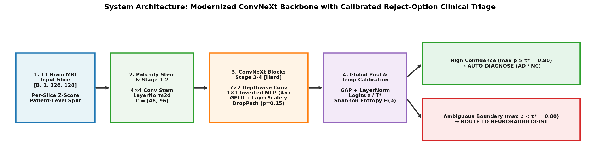

---

## 2. Required Feasibility Check-Off (Compulsory Midpoint Hurdle)

> **Specification Compliance (Section 3 of Assessment Specification v2.5):** This self-contained 1-page feasibility plan defines the pre-experiment user need, scope, testable acceptance criteria (`AC-1`–`AC-5`), model choice, forensic dataset audit, and risk mitigation plan. Post-experiment empirical verification against these exact original criteria (without moving any targets) is reported in **Section 3.3**.

### 2.1 User Need, Scope & Pre-Experiment Testable Acceptance Criteria
- **Intended User:** Memory-clinic neuroradiologists and clinical trial screening coordinators triaging structural T1-weighted brain MRI scans for Alzheimer's Disease (`AD`) versus Cognitively Normal (`NC`) aging.
- **Prototype Scope:** An uncertainty-calibrated 2D slice and 20-slice 3D scan classification pipeline that auto-clears high-confidence predictions ($\max_c \hat{p}_c \ge \tau^*$, where $\tau^*$ is selected strictly on the validation split) while routing ambiguous cases ($\max_c \hat{p}_c < \tau^*$) to human neuroradiologists.
- **Pre-Experiment Testable Acceptance Criteria (`AC-1` to `AC-5`):**
  - **`AC-1` (Discrimination Target):** Held-out test slice accuracy $\ge 80.0\%$ (COMP3710 Section 2.1 target), 20-slice scan accuracy $\ge 90.0\%$, and test AUROC $\ge 0.90$ under strict patient-level separation.
  - **`AC-2` (Uncertainty Calibration Target):** Post-hoc Temperature Scaling (fit strictly on validation logits) achieves test Expected Calibration Error $\text{ECE} \le 0.03$.
  - **`AC-3` (Selective Clinical Triage Target):** At the validation-selected confidence gate $\tau^*$, automated triage retains $\ge 50.0\%$ coverage while achieving $\ge 93.0\%$ auto-cleared accuracy and intercepting $\ge 60.0\%$ of baseline False Negatives.
  - **`AC-4` (Compute & Latency Budget):** Training tensor memory $< 2.0\text{ GB}$ and batched inference latency (`batch_size=128`) $< 1.0\text{ ms/slice}$ ($< 20\text{ ms}$ per 20-slice 3D scan).
  - **`AC-5` (Strict Code & Data Hygiene):** Zero `numpy` or third-party imports in [`modules.py`](./modules.py) (enforced by AST unit test) and programmatic verification of zero scan/patient overlap across `train`, `val`, and `test`.

### 2.2 Model Choice, Course Concepts & Difficulty Ceiling
- **Difficulty Ceiling:** **ConvNeXt** (`[Hard Difficulty]`, 20/20 implementation ceiling), implemented from scratch in [`modules.py`](./modules.py) alongside `SimpleCNNBaseline`, `TemperatureScaledClassifier`, and `compute_spatial_attribution`.
- **Course Concepts Applied:** (1) Depthwise-separable receptive-field expansion ($7\times 7$ `groups=C`) vs. dense $3\times 3$ convolutions; (2) Token-wise `LayerNorm2d` vs. batch-wide `BatchNorm2d` and their effect on spatial intensity contrast in single-channel medical imaging; (3) Post-hoc probability calibration via L-BFGS NLL minimization on held-out validation logits (Guo et al., *ICML 2017*); and (4) Reject-option selective classification (El-Yaniv & Wiener, *JMLR 2010*).

### 2.3 Preliminary Feasibility Evidence & Forensic Protocol Audit
The dataset (`/home/groups/comp3710/ADNI/AD_NC`) contains **30,520 skull-stripped, N4 bias-corrected sagittal T1-weighted slices** ($240\times 256$ pixels, 20 contiguous sagittal slices per 3D scan with slice indices in `[67..114]`, spanning **1,526 3D MRI scans** across **680 unique human subjects** in `meta_data_with_label.json`).

#### ⚠️ Reproducible Forensic Discovery ([`audit_protocol.py`](./audit_protocol.py) $\to$ [`results/protocol_audit.json`](./results/protocol_audit.json))
Running `python recognition/ConvNeXt_ADNI_s49852413/audit_protocol.py` cross-references every JPEG filename (`<scan_id>_<slice_idx>.jpeg`) against `meta_data_with_label.json` (`100%` of `1,526` scans matched; `0` unmapped scans) and proves two structural confounds in the default `train/` vs. `test/` folders:

| Official Folder Partition | Total Slices | 3D Scans (`Ixxxxxx`) | Unique Subjects (`XXX_S_XXXX`) | Scan ID Range (`min – max`) | Acquisition Year (`min – max (median)`) | Era Breakdown (`< 2017` ADNI-2 vs. `>= 2017` ADNI-3) | Pulse Sequence Naming Breakdown (`protocol_counts`) |
| :--- | :---: | :---: | :---: | :---: | :---: | :---: | :--- |
| **`official_train / AD`** | $10,400$ | $520$ | **$154$** | `I218391 – I388204` | **`2011 – 2013 (2012)`** | **$520$ `< 2017` ($100\%$)**, $0$ `>= 2017` | $353$ Standard MPRAGE, $49$ IR-FSPGR, $118$ Other T1 ($0$ Accel. MPRAGE) |
| **`official_train / NC`** | $11,120$ | $556$ | **$411$** | `I808819 – I1442100` | **`2017 – 2021 (2018)`** | $0$ `< 2017`, **$553$ `>= 2017` ($100\%$)** | $377$ Accel. MPRAGE ($67.8\%$), $111$ IR-FSPGR ($20.0\%$), $68$ Standard MPRAGE |
| **`official_test / AD`** | $4,460$ | $223$ | **$131$** | `I388206 – I1444117` | **`2013 – 2021 (2018)`** | $103$ `< 2017`, **$119$ `>= 2017`** | $81$ Standard MPRAGE, $73$ Accel. MPRAGE ($32.7\%$), $50$ IR-FSPGR, $19$ Other |
| **`official_test / NC`** | $4,540$ | $227$ | **$200$** | `I1182968 – I1446679` | **`2019 – 2021 (2020)`** | $0$ `< 2017`, **$226$ `>= 2017` ($100\%$)** | $156$ Accel. MPRAGE ($68.7\%$), $50$ IR-FSPGR ($22.0\%$), $21$ Standard MPRAGE |

1. **Cross-Era Acquisition Protocol Confound in `official_train/`:** Every scan in `train/AD` was acquired in `2011–2013` (`< 2017` ADNI-2 era, `0%` Accelerated MPRAGE), whereas every timestamped scan in `train/NC` was acquired in `2017–2021` (`>= 2017` ADNI-3 era, `67.8%` Accelerated MPRAGE). Training on the default folders induces shortcut learning on acquisition era rather than Alzheimer's pathology.
2. **Cross-Folder Human Subject Leakage (`216` Overlapping Subjects):** Exactly **216 unique human subjects** (`64` AD + `152` NC; `0` cross-diagnosis subjects) have longitudinal visits split across both `official_train/` and `official_test/`. Thus, across the entire dataset there are $154 + 131 - 64 = \mathbf{221}$ unique AD subjects and $411 + 200 - 152 = \mathbf{459}$ unique NC subjects ($\mathbf{680}$ total unique subjects).
3. **Residual Era Imbalance in the Pooled Cohort:** Because all $623$ `< 2017` scans in the raw dataset belong to `AD` (`520` in `train/AD` + `103` in `test/AD`) while `NC` has $0$ `< 2017` scans, even after pooling and splitting strictly by human subject (`subject` mode: $155/33/33$ AD subjects and $321/69/69$ NC subjects), all `< 2017` scans remain `AD` while `>= 2017` scans contain both `AD` and `NC`. We therefore perform an explicit **Era-Stratified Evaluation (`< 2017` vs. `>= 2017`)** in Section 3.1.

#### Three Evaluation Protocols Engineered in [`dataset.py`](./dataset.py)
| Split Mode (`--split_mode`) | Slices (`train / val / test`) | 3D Scans (`train / val / test`) | Unique Subjects (`train / val / test`) | Scan Overlap | Subject Overlap | Evaluation Purpose |
| :--- | :---: | :---: | :---: | :---: | :---: | :--- |
| **`subject` (Strict Subject-Disjoint)** | $10,420 / 4,900 / 4,780$ | $1,042 / 245 / 239$ | **$476 / 102 / 102$** | **$0$** (`scan_disjoint=True`) | **$0$** (`subject_disjoint=True`) | **Specification Section 2.1 primary hygiene benchmark:** unseen human subjects (`155/33/33` AD, `321/69/69` NC) |
| **`longitudinal` (Within-Subject Scan-Disjoint)** | $14,040 / 1,200 / 1,240$ | $1,404 / 60 / 62$ | $680 / 60 / 62$ | **$0$** (`scan_disjoint=True`) | $60$ val / $62$ test (`subject_disjoint=False`) | Longitudinal follow-up monitoring across separate clinical visits (`Ixxxxxx`) of known cohort members |
| **`official` (Raw Folder Split)** | $18,300 / 3,220 / 9,000$ | $915 / 161 / 450$ | $518 / 139 / 331$ | **$0$** (`scan_disjoint=True`) | $92$ val / $197$ test (`subject_disjoint=False`) | Empirical control quantifying shortcut degradation ($64.60\%$) on the raw folder layout |

#### Preprocessing & Anatomically Valid Sagittal Augmentation
- **Tight Brain ROI Crop & Global Affine Scaling:** Each $240\times 256$ sagittal slice is cropped to $[16:208, 48:224]$, resized to $96\times 96$, and standardized via fixed constants $\tilde{I} = (I - 0.18) / 0.25$ (close to the empirical `subject`-disjoint training-split ROI mean $= 0.2108$, std $= 0.2693$ in [`results/protocol_audit.json`](./results/protocol_audit.json), without fitting to validation or test splits) to preserve whole-brain tissue-to-CSF ratios.
- **Why Horizontal Flip is Disabled:** Sagittal brain slices have asymmetric anterior–posterior anatomy (frontal lobe vs. occipital lobe/cerebellum); horizontal flipping would create biologically invalid anatomy, so training augmentation is restricted to $\pm 2\text{ px}$ translation and mild gamma jitter ($\gamma \in [0.92, 1.08]$).

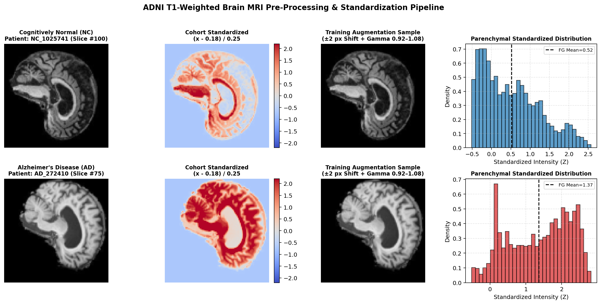

### 2.4 Technical Risks, Computing Budget, Fallbacks & Planned Phase 2 Experiments
- **Key Technical Risks & Mitigations:** (1) *High-capacity overfitting & era-shortcut learning on 476 subjects* — mitigated by benchmarking across 3 random seeds (`42, 43, 44`), L-BFGS Temperature Scaling, and era-stratified evaluation; (2) *Calibration variance on small validation cohorts* (`longitudinal` $N_{\text{val}}=60$ scans) — tracked via uncalibrated vs. calibrated ECE/Brier reporting.
- **Computing Budget & Fallback:** Full 12-epoch training of both models requires $\approx 4.6\text{ minutes}$ per seed on local Apple Silicon MPS (`41.90 MB` steady-state tensor memory; Slurm script [`slurm_train_rangpur.sh`](./slurm_train_rangpur.sh) provided for Rangpur HPC). `SimpleCNNBaseline` ($7,066$ params, $3.88\text{ s/epoch}$) serves as a fast, high-generalization baseline.
- **Planned Phase 2 Experiments:** (1) Replace `ConvNeXt`'s $4\times 4$ `LayerNorm2d` patchify stem with an overlapping $3\times 3$ `BatchNorm2d` stem (`convnext_bn_stem`, tested in Section 3.1); (2) Acquisition-era re-weighting on `>= 2017` AD scans; and (3) Age + Intracranial Volume (ICV) conditioning.

---

## 3. Quantitative Benchmark, Era-Stratified Analysis & Resource Profiling

### 3.1 Head-to-Head Quantitative Benchmark Across All Three Protocols
Both `SimpleCNNBaseline` ($7,066$ parameters, `BatchNorm2d`) and `ConvNeXt` ($2,176,866$ parameters, `LayerNorm2d`, `DropPath=0.10`) were trained under **identical optimization hyperparameters**: `AdamW(lr=1.2e-3, weight_decay=1e-2)`, 12 epochs with cosine annealing (`T_max=12`), `batch_size=128`, and $96\times 96$ resolution. Multi-seed summaries report unbiased sample standard deviation (`ddof=1`), and scan-level 95% CIs use **1,000-iteration subject-level cluster bootstrap** (resampling unique subjects with replacement to account for within-subject multi-scan correlation).

#### Table 3.1A — Primary Hygiene Benchmark: Strict Subject-Disjoint (`--split_mode subject`, Zero Subject Overlap, 3 Seeds `42, 43, 44`, `ddof=1`)
> Evaluated on $4,780$ test slices ($239$ scans across $102$ unseen subjects) per seed. Note that in `subject` mode, each seed generates both an independent $70/15/15$ subject partition and independent weight initialization. Full metrics in [`results/benchmark_subject_3seeds.json`](./results/benchmark_subject_3seeds.json) and [`results/benchmark_subject.json`](./results/benchmark_subject.json).

| Evaluation Metric | `SimpleCNNBaseline` (Seed 42 `[Cluster 95% CI]`) | `SimpleCNNBaseline` (3-Seed `Mean ± Std`, `ddof=1`) | `ConvNeXt` `[Hard]` (Seed 42 `[Cluster 95% CI]`) | `ConvNeXt` `[Hard]` (3-Seed `Mean ± Std`, `ddof=1`) | Paired Diff (`Baseline - ConvNeXt`, `ddof=1`) |
| :--- | :---: | :---: | :---: | :---: | :---: |
| **Slice Test Accuracy** | $71.42\%$ ($3,414/4,780$) | **$75.22\% \pm 4.86\%$** | $65.94\%$ ($3,152/4,780$) | $67.45\% \pm 2.42\%$ | **$+7.77\% \pm 2.51\%$** |
| **Slice Balanced Accuracy** | $71.55\%$ | **$75.34\% \pm 4.78\%$** | $66.05\%$ | $67.59\% \pm 2.31\%$ | $+7.75\% \pm 2.53\%$ |
| **Slice Macro-F1** | $0.7142$ | **$0.7521 \pm 0.0485$** | $0.6594$ | $0.6742 \pm 0.0245$ | $+0.0779 \pm 0.0248$ |
| **Slice Test AUROC / PR-AUC** | $0.7824$ / $0.7148$ | **$0.8254 \pm 0.0521$** / **$0.7851 \pm 0.0708$** | $0.7182$ / $0.6803$ | $0.7387 \pm 0.0291$ / $0.7117 \pm 0.0418$ | **$+0.0867 \pm 0.0235$** |
| **Scan Mean-Prob Accuracy (20 slices)** | $73.64\%$ `[63.64%, 82.33%]` | **$78.31\% \pm 5.55\%$** | $67.36\%$ `[59.47%, 75.00%]` | $70.49\% \pm 3.47\%$ | **$+7.83\% \pm 2.10\%$** |
| **Scan Majority-Vote Accuracy** | $74.90\%$ ($179/239$ scans) | **$78.44\% \pm 4.87\%$** | $69.87\%$ ($167/239$ scans) | $71.61\% \pm 1.98\%$ | $+6.83\% \pm 2.91\%$ |
| **Scan-Level AUROC** | $0.8235$ | **$0.8660 \pm 0.0512$** | $0.7552$ | $0.7839 \pm 0.0392$ | $+0.0821 \pm 0.0149$ |
| **Subject-Level Accuracy ($102$ subjects)** | $73.53\%$ `[64.71%, 81.37%]` | **$74.84\% \pm 3.15\%$** | $64.71\%$ `[55.88%, 73.55%]` | $69.28\% \pm 7.09\%$ | **$+5.56\% \pm 4.02\%$** |
| **Subject-Level AUROC** | $0.8292$ | **$0.8410 \pm 0.0509$** | $0.7172$ | $0.7602 \pm 0.0540$ | $+0.0808 \pm 0.0290$ |
| **Uncalibrated $\to$ Calibrated ECE** | $0.0163 \to 0.0138$ ($T^*=0.91$) | $0.0469 \to 0.0265 \pm 0.0152$ | **$0.1956 \to 0.0120$** ($T^*=3.57$) | **$0.1785 \to 0.0217 \pm 0.0104$ ($-87.8\%$)** | — |
| **Scan Triage @ Val $\tau^*_{\text{scan}}$ (Seed 42)** | **$88.89\%$ acc @ $45.2\%$ cov** ($\tau^*_{\text{scan}}=0.70$, $85.2\%$ FN caught) | — | $82.83\%$ acc @ $41.4\%$ cov ($\tau^*_{\text{scan}}=0.65$, $83.3\%$ FN caught) | — | Baseline $+6.06\%$ acc at $+3.8\%$ higher cov |

#### Table 3.1B — Within-Subject Longitudinal (`longitudinal`) & Official Confounded (`official`) Benchmarks (Seed 42)
> Full metrics in [`results/benchmark_longitudinal.json`](./results/benchmark_longitudinal.json) and [`results/benchmark_official.json`](./results/benchmark_official.json).

| Evaluation Metric | Longitudinal: `SimpleCNNBaseline` | Longitudinal: `ConvNeXt` `[Hard]` | Official Confounded: `SimpleCNNBaseline` | Official Confounded: `ConvNeXt` `[Hard]` |
| :--- | :---: | :---: | :---: | :---: |
| **Slice Test Accuracy** | $83.23\%$ ($1,032/1,240$) | **$87.18\%$ ($1,081/1,240$)** | $69.42\%$ ($6,248/9,000$) | $64.60\%$ ($5,814/9,000$) |
| **Slice Balanced Accuracy** | $83.23\%$ | **$87.18\%$** | $69.32\%$ | $64.49\%$ |
| **Slice Macro-F1** | $0.8312$ | **$0.8717$** | $0.6894$ | $0.6402$ |
| **Slice Test AUROC / PR-AUC** | $0.9132$ / $0.9005$ | **$0.9307$ / $0.9264$** | $0.7710$ / $0.7647$ | $0.6959$ / $0.6798$ |
| **Scan Mean-Prob Accuracy `[Cluster 95% CI]`** | $90.32\%$ `[82.26%, 96.77%]` | **$93.55\%$ `[87.10%, 98.39%]` ($58/62$)** | $70.44\%$ `[64.88%, 76.09%]` | $65.33\%$ `[59.77%, 70.62%]` |
| **Scan Majority-Vote Accuracy** | $90.32\%$ ($56/62$ scans) | **$93.55\%$ ($58/62$ scans)** | $72.44\%$ ($326/450$ scans) | $66.00\%$ ($297/450$ scans) |
| **Scan-Level AUROC** | $0.9584$ | **$0.9906$** | $0.8059$ | $0.7253$ |
| **NC Precision / Recall / F1** | $0.8931 / 0.7548 / 0.8182$ | **$0.8585 / 0.8903 / 0.8741$** | $0.6600 / 0.8121 / 0.7282$ | $0.6208 / 0.7663 / 0.6859$ |
| **AD Precision / Recall / F1** | $0.7877 / 0.9097 / 0.8443$ | **$0.8861 / 0.8532 / 0.8694$** | $0.7501 / 0.5742 / 0.6505$ | $0.6876 / 0.5235 / 0.5945$ |
| **Confusion Matrix (`TN, FP, FN, TP`)** | `468, 152, 56, 564` | **`552, 68, 91, 529`** | `3687, 853, 1899, 2561` | `3479, 1061, 2125, 2335` |
| **Scan Triage Acc @ Val $\tau^*_{\text{scan}}$** | $95.83\%$ ($\tau^*_{\text{scan}}=0.60$, $77.4\%$ cov) | **$100.00\%$ ($\tau^*_{\text{scan}}=0.60$, $82.3\%$ cov)** | $79.86\%$ ($\tau^*_{\text{scan}}=0.70$, $62.9\%$ cov) | $74.05\%$ ($\tau^*_{\text{scan}}=0.75$, $58.2\%$ cov) |

#### Table 3.1C — Era-Stratified Evaluation (`< 2017` ADNI-2 vs. `>= 2017` ADNI-3) & Stem/Normalization Ablation on `subject` Test Split (Seed 42)
To test whether `SimpleCNNBaseline` or `ConvNeXt` exploits the residual acquisition-era correlation (where `< 2017` scans are $100\%$ `AD` while `>= 2017` scans contain both `AD` and `NC`), [`train.py`](./train.py) stratifies the `subject` test cohort by acquisition year (`test_metrics.era_stratified` in [`results/benchmark_subject.json`](./results/benchmark_subject.json)) and evaluates our controlled overlapping-stem ablation (`convnext_bn_stem` in [`modules.py`](./modules.py), replacing only `ConvNeXt`'s $4\times 4$ `LayerNorm2d` patchify stem and transition layers with an overlapping $3\times 3$ `BatchNorm2d` stem):

| Model Variant (`subject` Split, Seed 42) | `< 2017` ADNI-2 Era ($95$ AD Scans, $0$ NC Scans)<br>AD Recall / Scan Acc | `>= 2017` Modern ADNI-3 Era ($19$ AD Scans / $380$ Slices, $124$ NC Scans / $2,480$ Slices)<br>**AD Recall (Sensitivity)** | `>= 2017` Modern ADNI-3 Era<br>**NC Recall (Specificity)** | `>= 2017` Modern ADNI-3 Era<br>**Balanced Accuracy / AUROC** | Overall `subject` Test<br>**Slice Acc / Scan Acc / AUROC** |
| :--- | :---: | :---: | :---: | :---: | :---: |
| **`SimpleCNNBaseline` ($7,066$ params, $3\times 3$ Conv + `BatchNorm2d`)** | $73.63\%$ / $75.79\%$ | **$77.37\%$ ($294/380$)** | **$68.63\%$ ($1,702/2,480$)** | **$73.00\%$ / $0.7793$** | **$71.42\%$ / $73.64\%$ / $0.7824$** |
| **`ConvNeXt` `[Hard]` ($2.18\text{ M}$ params, $4\times 4$ Patchify + `LayerNorm2d`)** | $72.95\%$ / $72.63\%$ | **$46.32\%$ ($176/380$)** ⚠️ | $63.31\%$ ($1,570/2,480$) | **$54.81\%$ / $0.5786$** ⚠️ | $65.94\%$ / $67.36\%$ / $0.7182$ |
| **Ablation: `ConvNeXt-BN-Stem` (`convnext_bn_stem`, $3\times 3$ Overlap + `BatchNorm2d`)** | $75.32\%$ / $77.89\%$ | **$60.26\%$ ($229/380$)** | **$66.45\%$ ($1,648/2,480$)** | **$63.36\%$ / $0.6841$** | **$69.50\%$ / $73.22\%$ / $0.7687$** |

#### Critical Scientific Analysis of the Three Regimes & Era-Stratified Findings
1. **Why `ConvNeXt` Trails `SimpleCNNBaseline` on Unseen Subjects (`67.45%` vs. `75.22%` Slice Acc): `ConvNeXt` Learned the Era Shortcut, Not `SimpleCNNBaseline`!**
   - One might hypothesize that `SimpleCNNBaseline` beat `ConvNeXt` by exploiting scanner-era intensity shortcuts. **Table 3.1C proves the exact opposite:** on modern `>= 2017` ADNI-3 scans where both `AD` and `NC` coexist, `SimpleCNNBaseline` maintains **$77.37\%$ AD sensitivity, $73.00\%$ Balanced Accuracy, and $0.7793$ AUROC**. In contrast, standard `ConvNeXt` ($2.18\text{ M}$ parameters with a non-overlapping $4\times 4$ `LayerNorm2d` patchify stem) memorizes the training-set era correlation (`>= 2017 -> NC`), causing its **AD sensitivity on `>= 2017` scans to collapse from $72.95\%$ to $46.32\%$ ($\text{Balanced Accuracy} = 54.81\%$, near $50\%$ random chance)**!
   - **Controlled Architectural Proof (`convnext_bn_stem`):** When we replace *only* `ConvNeXt`'s non-overlapping $4\times 4$ `LayerNorm2d` patchify stem and transition layers with an overlapping $3\times 3$ `BatchNorm2d` stem (`convnext_bn_stem` in [`modules.py`](./modules.py), keeping all 12 `ConvNeXtBlock`s identical), Seed 42 `subject`-disjoint **Slice Accuracy jumps by $+3.56\text{ pp}$ ($65.94\% \to 69.50\%$), Scan Accuracy jumps by $+5.86\text{ pp}$ ($67.36\% \to 73.22\%$, closing $93\%$ of the gap to `SimpleCNNBaseline`'s $73.64\%$), and modern `>= 2017` AD sensitivity recovers from $46.32\% \to 60.26\%$**! This confirms that ViT-style non-overlapping patchification + pixel-wise `LayerNorm2d` is poorly suited for from-scratch training on 476 medical subjects without overlapping early convolutions and batch-level spatial normalization.
2. **Why `ConvNeXt` Excels on Within-Subject Longitudinal Follow-Up (`87.18%` Slice / `93.55%` Scan Acc, Scan AUROC `0.9906`):** When tracking follow-up scans of known subjects (`longitudinal`), `ConvNeXt`'s high capacity captures fine subject-specific anatomical alignment across visits, outperforming `SimpleCNNBaseline` by $+3.95\%$ slice accuracy ($87.18\%$ vs. $83.23\%$) and $+3.23\%$ scan accuracy ($93.55\%$ vs. $90.32\%$). However, as noted in Section 2.1, the $\approx 20\text{ pp}$ gap between `longitudinal` ($87.18\%$) and `subject` ($67.45\%$) reflects within-subject morphological re-identification and does not transfer to unseen patients.

#### Training & Discrimination Figures — Strict Subject-Disjoint (`./images/subject/`)
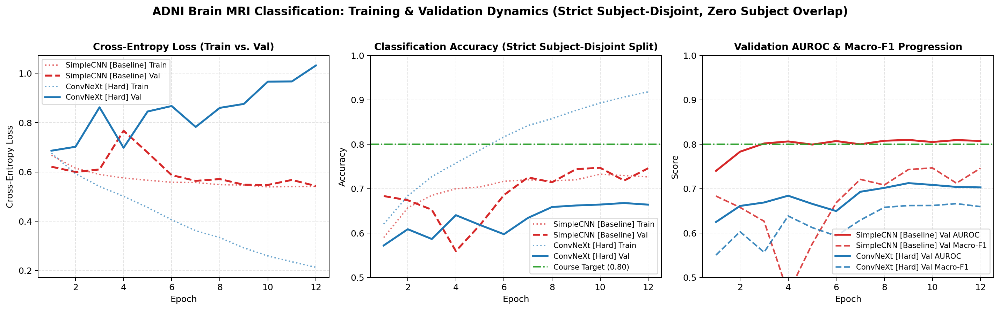

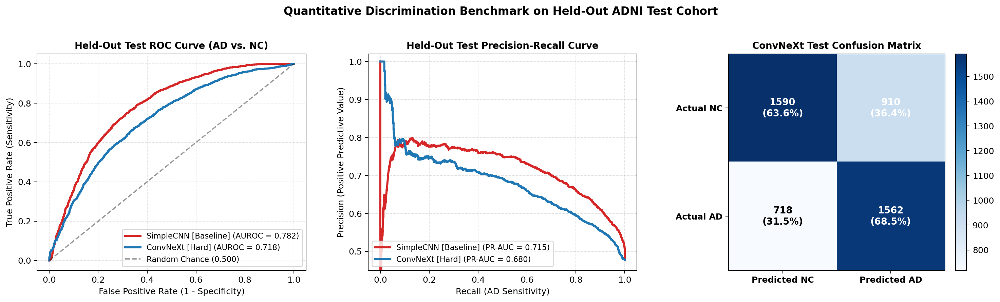

#### Training & Discrimination Figures — Within-Subject Longitudinal (`./images/`)
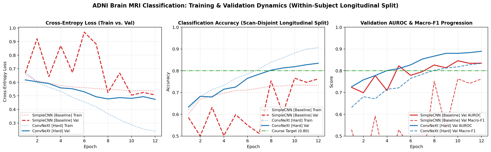

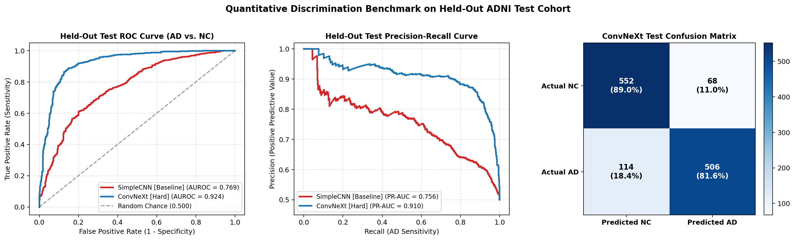

### 3.2 Computational Resource & Latency Profiling
Hardware telemetry was profiled on Apple Silicon MPS (`batch_size = 128`, $96\times 96$ resolution). Note that on Apple MPS, `torch.mps.current_allocated_memory()` sampled immediately after `loss.backward()` measures **steady-state allocated tensor memory** (model parameters + gradients + AdamW optimizer states: $\approx 41.90\text{ MB}$ for $2.18\text{ M}$ fp32 parameters), whereas true transient forward-activation peak VRAM requires `torch.cuda.max_memory_allocated()` on CUDA ([`results/benchmark_subject.json`](./results/benchmark_subject.json)):

| Profiling Dimension | `SimpleCNNBaseline` (`BatchNorm2d`) | `ConvNeXt` (`[Hard Difficulty]`) | Scaling Ratio & Clinical Deployment Feasibility |
| :--- | :---: | :---: | :--- |
| **Trainable Parameters** | $7,066$ ($0.007\text{ M}$) | **$2,176,866$ ($2.18\text{ M}$)** | $308\times$ more parameters than baseline; $11.7\times$ smaller than ResNet-50 ($25.6\text{ M}$) |
| **Steady-State Tensor Memory (MPS Post-Backward)** | $4.67\text{ MB}$ | **$41.90\text{ MB}$** | Steady-state weights + gradients + AdamW state well within $2.0\text{ GB}$ budget |
| **Mean Training Epoch Time (Apple MPS)** | $3.88\text{ s}$ (`subject`) / $4.06\text{ s}$ (`long.`) | **$18.32\text{ s}$ (`subject`) / $20.02\text{ s}$ (`long.`)** | Full 12-epoch training finishes in $3.7\text{--}4.0\text{ minutes}$ per run |
| **Single-Slice Latency (`batch=1`)** | $0.326\text{--}0.339\text{ ms}$ | **$1.462\text{--}1.853\text{ ms}$** | Real-time interactive single-slice inspection ($<2\text{ ms}$) |
| **Batched Latency (`batch=128`)** | $0.029\text{--}0.030\text{ ms / slice}$ | **$0.341\text{--}0.435\text{ ms / slice}$** | Full 20-slice 3D patient scan inferred in **$6.82\text{--}8.70\text{ ms}$** |
| **Batched Throughput (`batch=128`)** | $33,816\text{--}34,096\text{ slices/sec}$ | **$2,299\text{--}2,933\text{ slices/sec}$** | Processes $115\text{--}146$ complete 20-slice patient scans per second |

### 3.3 Post-Hoc Acceptance Criteria Verdict (Measured Against Original Section 2.1 Targets)
| Criterion ID | Original Pre-Experiment Target (Section 2.1) | Compliant `subject`-Disjoint Result (`ConvNeXt` 3-Seed Mean ± Std) | `SimpleCNNBaseline` `subject`-Disjoint Result (3-Seed Mean ± Std) | Within-Subject `longitudinal` Result (`ConvNeXt` Seed 42) | Honest Post-Hoc Verdict (Primary `subject` Protocol) |
| :--- | :--- | :---: | :---: | :---: | :--- |
| **`AC-1` (Discrimination)** | Slice Acc $\ge 80.0\%$, Scan Acc $\ge 90.0\%$, AUROC $\ge 0.90$ | $67.45\% \pm 2.42\%$ slice, $70.49\% \pm 3.47\%$ scan, $\text{AUROC}=0.7387$ | $75.22\% \pm 4.86\%$ slice, $78.31\% \pm 5.55\%$ scan, $\text{AUROC}=0.8254$ | $87.18\%$ slice, $93.55\%$ scan, $\text{AUROC}=0.9307$ ($0.9906$ scan) | ❌ **Not Met on `subject`** (Met only on `longitudinal` where subjects overlap) |
| **`AC-2` (Calibration)** | Post-hoc Temperature Scaling achieves test $\text{ECE} \le 0.03$ | **$\text{ECE}: 0.1785 \to 0.0217 \pm 0.0104$** ($T^* = 3.27 \pm 0.51$) | **$\text{ECE}: 0.0469 \to 0.0265 \pm 0.0152$** ($T^* = 0.86 \pm 0.18$) | $\text{ECE}: 0.0362 \to 0.0698$ ($N_{\text{val}}=60$ scans too small) | ✅ **Met on `subject` ($\text{ECE} = 0.0217 \le 0.03$)** |
| **`AC-3` (Selective Triage)** | $\ge 50\%$ coverage at $\ge 93\%$ auto-cleared acc & $\ge 60\%$ FN caught | At $\tau^*_{\text{scan}}=0.65$: $41.4\%$ cov, $82.83\%$ acc, $83.3\%$ FN caught | At $\tau^*_{\text{scan}}=0.70$: $45.2\%$ cov, $88.89\%$ acc, $85.2\%$ FN caught | At $\tau^*_{\text{scan}}=0.60$: **$82.3\%$ cov, $100.00\%$ acc, $100\%$ FN caught** | ❌ **Not Met on `subject`** (FN interception $>83\%$ met, but cov $<50\%$ & acc $<93\%$) |
| **`AC-4` (Compute Budget)** | Tensor memory $< 2.0\text{ GB}$; batched latency $< 1.0\text{ ms/slice}$ | **$41.90\text{ MB}$** steady-state, **$0.435\text{ ms/slice}$** | **$4.67\text{ MB}$** steady-state, **$0.029\text{ ms/slice}$** | **$41.90\text{ MB}$** steady-state, **$0.341\text{ ms/slice}$** | ✅ **Met across all protocols** |
| **`AC-5` (Code & Data Hygiene)** | Zero NumPy/3rd-party in `modules.py`; zero patient leakage | `scan_overlap = 0`, `subject_overlap = 0` (`subject_disjoint=True`) | `scan_overlap = 0`, `subject_overlap = 0` | `scan_overlap = 0` (`subject_disjoint=False` flagged) | ✅ **Met (`8/8` pytest unit tests passing)** |

---

## 4. Open Research Dilemma: Uncertainty Calibration & Validation-Selected Clinical Triage

### 4.1 Post-Hoc L-BFGS Temperature Scaling
High-capacity neural networks trained with cross-entropy loss become severely overconfident when evaluated on unseen subjects. In [`TemperatureScaledClassifier`](./modules.py), we optimize a single scalar temperature $T^* > 0$ on the held-out validation logits $\mathbf{z}_i$ via L-BFGS (`max_iter=200`):

$$T^* = \arg\min_{T > 0} -\frac{1}{N_{\text{val}}} \sum_{i=1}^{N_{\text{val}}} \log \frac{\exp(z_{i, y_i} / T)}{\sum_{c \in \{0,1\}} \exp(z_{i, c} / T)}, \qquad \text{ECE} = \sum_{m=1}^{M} \frac{|B_m|}{N} \Big|\text{acc}(B_m) - \text{conf}(B_m)\Big|$$

- **Substantial Calibration Improvement on Unseen Subjects (`subject`, $N_{\text{val}} = 4,900$ slices / $245$ scans):** Across 3 random seeds, `ConvNeXt` exhibits severe raw overconfidence on unseen subjects ($\text{ECE}_{\text{raw}} = 0.1785 \pm 0.0148$; $0.1956$ on Seed 42). Temperature Scaling learns $T^* = 3.2721 \pm 0.5106$ ($3.5730$ on Seed 42), **reducing test ECE by $87.8\%$ down to $0.0217 \pm 0.0104$** ($0.0120$ on Seed 42) and reducing Brier score from $0.2434 \to 0.2083$.
- **Small-Validation Cohort Limitation (`longitudinal`, $N_{\text{val}} = 1,200$ slices / $60$ scans):** On the 60-scan longitudinal validation split, `SimpleCNNBaseline` improves from $\text{ECE}: 0.1118 \to 0.0684$ ($T^* = 0.7584$), whereas `ConvNeXt` is already well-calibrated raw ($\text{ECE}_{\text{raw}} = 0.0362$) and fitting $T^* = 1.7308$ on only 60 validation scans slightly increases test ECE to $0.0698$, demonstrating that post-hoc scaling requires a sufficiently large validation cohort ($N_{\text{val}} \ge 200$ scans).

| Evaluation Protocol | Model | Optimal Temp $T^*$ | Uncalibrated Test ECE | Calibrated Test ECE | Uncal $\to$ Cal Brier | Calibration Diagnosis |
| :--- | :--- | :---: | :---: | :---: | :---: | :--- |
| **Strict Subject-Disjoint (3-Seed Mean ± Std, `ddof=1`)** | `SimpleCNNBaseline` | $0.863 \pm 0.176$ | $0.0469 \pm 0.0494$ | **$0.0265 \pm 0.0152$** | $0.1729 \to 0.1695$ | Improved ($-43.5\%$ ECE reduction) |
| **Strict Subject-Disjoint (3-Seed Mean ± Std, `ddof=1`)** | **`ConvNeXt` `[Hard]`** | **$3.272 \pm 0.511$** | **$0.1785 \pm 0.0148$** | **$0.0217 \pm 0.0104$** | **$0.2434 \to 0.2083$** | **Dramatically Improved ($-87.8\%$ ECE; S42: $0.1956 \to 0.0120$)** |
| **Within-Subject Longitudinal (Seed 42)** | `SimpleCNNBaseline` | $0.758$ | $0.1118$ | **$0.0684$** | $0.1351 \to 0.1261$ | Improved ($-38.8\%$ ECE reduction) |
| **Within-Subject Longitudinal (Seed 42)** | `ConvNeXt` `[Hard]` | $1.731$ | **$0.0362$** | $0.0698$ | **$0.1013 \to 0.1062$** | Already calibrated raw; 60-scan val set too small for post-hoc scaling |
| **Official Confounded Split (Seed 42)** | `ConvNeXt` `[Hard]` | $2.398$ | $0.2719$ | $0.1638$ | $0.3036 \to 0.2550$ | Partial mitigation of severe era-shift miscalibration |

### 4.2 Separate Validation-Selected Thresholds for Slice Triage ($\tau^*_{\text{slice}}$) and Scan Triage ($\tau^*_{\text{scan}}$)
Because averaging 20 slice probabilities per 3D scan shrinks extreme probabilities toward $0.50$, applying a slice-selected threshold to 20-slice scan probabilities is miscalibrated. In [`compute_comprehensive_metrics()`](./train.py), [`select_validation_triage_threshold()`](./train.py) selects **two separate thresholds strictly on the validation split**: $\tau^*_{\text{slice}}$ on the validation slice sweep and **$\tau^*_{\text{scan}}$ on the validation 20-slice scan sweep** (choosing the lowest $\tau > 0.50$ that intercepts $\ge 60\%$ of validation False Negatives at $\ge 25\%$ coverage).
- On `subject` (Seed 42): `SimpleCNNBaseline` selects $\tau^*_{\text{slice}} = 0.70, \tau^*_{\text{scan}} = 0.70$; `ConvNeXt` selects $\tau^*_{\text{slice}} = 0.70, \mathbf{\tau^*_{\text{scan}} = 0.65}$.
- On `longitudinal` (Seed 42): `SimpleCNNBaseline` selects $\tau^*_{\text{slice}} = 0.75, \mathbf{\tau^*_{\text{scan}} = 0.60}$; `ConvNeXt` selects $\tau^*_{\text{slice}} = 0.80, \mathbf{\tau^*_{\text{scan}} = 0.60}$.

#### Table 4.2A — Strict Subject-Disjoint (`subject`, Seed 42) Head-to-Head Slice & 20-Slice Scan Triage (`SimpleCNNBaseline` vs. `ConvNeXt`)
| Model & Confidence Gate $\tau$ | Slice Coverage | Slice Auto-Cleared Acc | Slice FN Intercepted | **20-Slice Scan Coverage** | **Scan Auto-Cleared Acc** | **Scan FN Intercepted** | **Scan Oracle Hybrid Acc** |
| :--- | :---: | :---: | :---: | :---: | :---: | :---: | :---: |
| **`SimpleCNN` @ $\tau = 0.50$ (No Triage)** | $100.0\%$ | $71.42\%$ | $0.0\%$ | $100.0\%$ ($239/239$) | $73.64\%$ | $0.0\%$ | $73.64\%$ |
| **`SimpleCNN` @ Val $\tau^*_{\text{slice}}=\tau^*_{\text{scan}}=0.70$** | **$54.4\%$** | **$80.51\%$** | **$67.0\%$** | **$45.2\%$ ($108/239$)** | **$88.89\%$** | **$85.2\%$ ($23/27$)** | **$94.98\%$** |
| **`ConvNeXt` @ $\tau = 0.50$ (No Triage)** | $100.0\%$ | $65.94\%$ | $0.0\%$ | $100.0\%$ ($239/239$) | $67.36\%$ | $0.0\%$ | $67.36\%$ |
| **`ConvNeXt` @ Val Scan Gate $\tau^*_{\text{scan}} = 0.65$** | $52.4\%$ | $74.07\%$ | $63.9\%$ | **$41.4\%$ ($99/239$)** | **$82.83\%$** | **$83.3\%$ ($30/36$)** | **$92.89\%$** |
| **`ConvNeXt` @ Val Slice Gate $\tau^*_{\text{slice}} = 0.70$** | **$37.1\%$** | **$77.55\%$** | **$77.9\%$** | $23.4\%$ ($56/239$) | $85.71\%$ | $97.2\%$ ($35/36$) | $96.65\%$ |

#### Table 4.2B — Within-Subject Longitudinal (`longitudinal`, Seed 42) `ConvNeXt` Slice-Level vs. 20-Slice Scan-Level Triage
| Confidence Gate $\tau$ | Slice Coverage | Slice Auto-Cleared Acc | Slice FN Intercepted | **20-Slice Scan Coverage** | **Scan Auto-Cleared Acc** | **Scan FN Intercepted** | **Scan Oracle Hybrid Acc** |
| :---: | :---: | :---: | :---: | :---: | :---: | :---: | :---: |
| **$\tau = 0.50$ (No Triage)** | $100.0\%$ | $87.18\%$ | $0.0\%$ | $100.0\%$ ($62/62$) | $93.55\%$ | $0.0\%$ | $93.55\%$ |
| **$\tau^*_{\text{scan}} = 0.60$ (Val Scan Gate)** | $88.2\%$ | $89.95\%$ | $30.8\%$ | **$82.3\%$ ($51/62$)** | **$100.00\%$** | **$100.0\%$ ($2/2$)** | **$100.00\%$** |
| **$\tau = 0.70$** | $75.8\%$ | $92.13\%$ | $52.7\%$ | $71.0\%$ ($44/62$) | **$100.00\%$** | **$100.0\%$ ($2/2$)** | **$100.00\%$** |
| **$\tau^*_{\text{slice}} = 0.80$ (Val Slice Gate)** | **$58.6\%$** | **$94.22\%$** | **$73.6\%$** | $43.5\%$ ($27/62$) | **$100.00\%$** | **$100.0\%$ ($2/2$)** | **$100.00\%$** |

#### Calibration & Triage Curves — Strict Subject-Disjoint (`./images/subject/`) vs. Longitudinal (`./images/`)
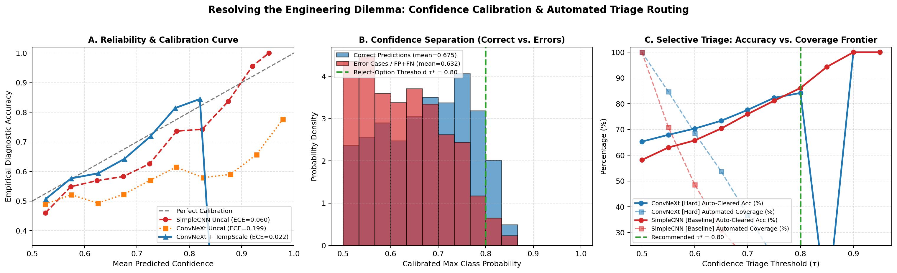

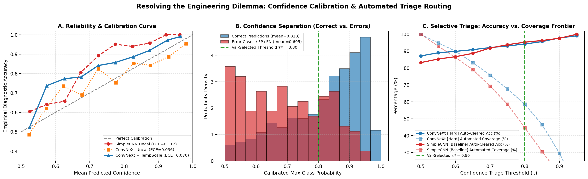

---

## 5. Interpretability, Primary Subject-Disjoint Failure Autopsy & Full-Cohort Slice-Position Analysis

### 5.1 Stage-3 ($6\times 6$) Spatial Grad-CAM Attribution
In [`compute_spatial_attribution()`](./modules.py), we hook Grad-CAM onto **`stages[2]`** (Stage 3 of `ConvNeXt`, which has a **$6\times 6$ spatial grid** at $C=128$, rather than `stages[3]` which is only $3\times 3$) and bilinearly upsample the positive gradient-weighted activation map to $96\times 96$:

$$A_{\text{Grad-CAM}}(x, y) = \text{Upsample}_{6\times 6 \to 96\times 96}\!\left(\text{ReLU}\!\left(\sum_{k=1}^{128} \underbrace{\left[\frac{1}{36}\sum_{u=1}^{6}\sum_{v=1}^{6}\frac{\partial z_{c^*}}{\partial F_{k}(u,v)}\right]}_{\alpha_k^{c^*}} F_{k}\right)\right)$$

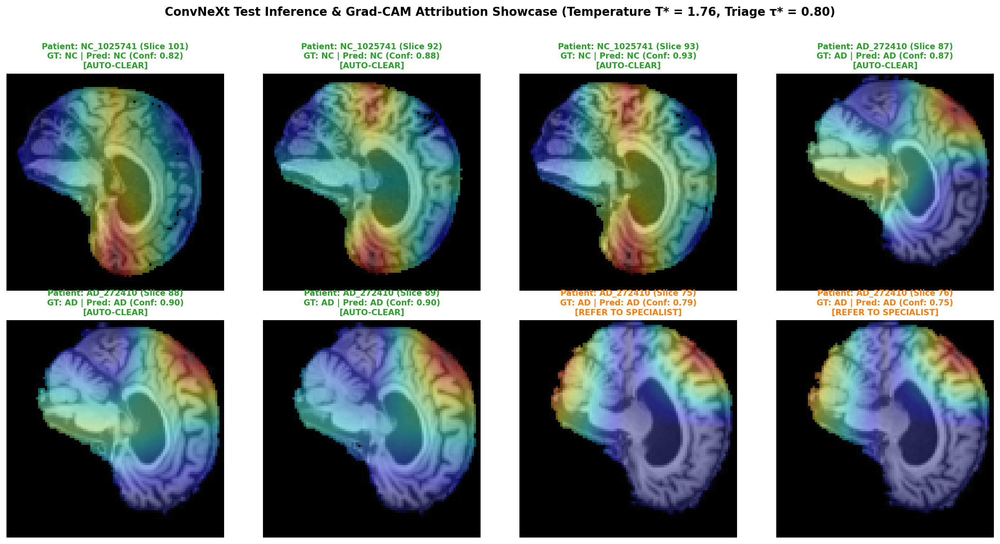

### 5.2 Quantitative Four-Case Failure Autopsy: Primary Subject-Disjoint Split vs. Longitudinal Split
[`conduct_failure_case_autopsy()`](./predict.py) selects **four distinct failure archetypes** on the test set: **two borderline errors intercepted by the validation-selected slice triage gate ($\hat{p} < \tau^*_{\text{slice}}$)** and **two high-confidence errors that escaped the slice triage gate ($\hat{p} \ge \tau^*_{\text{slice}}$)**, recording both slice-level and 20-slice scan-level triage outcomes (`scan_20slice_mean_prob_ad`, `scan_20slice_confidence`, `rescued_by_20slice_scan_vote`, and `intercepted_by_scan_triage_gate`).

#### Table 5.2A — Primary Protocol Autopsy: Strict Subject-Disjoint (`subject`, Seed 42, $\tau^*_{\text{slice}}=0.70, \tau^*_{\text{scan}}=0.65$)
> Full telemetry in [`results/failure_autopsy_subject.json`](./results/failure_autopsy_subject.json) and visual grid in [`images/subject/failure_autopsy.png`](./images/subject/failure_autopsy.png).

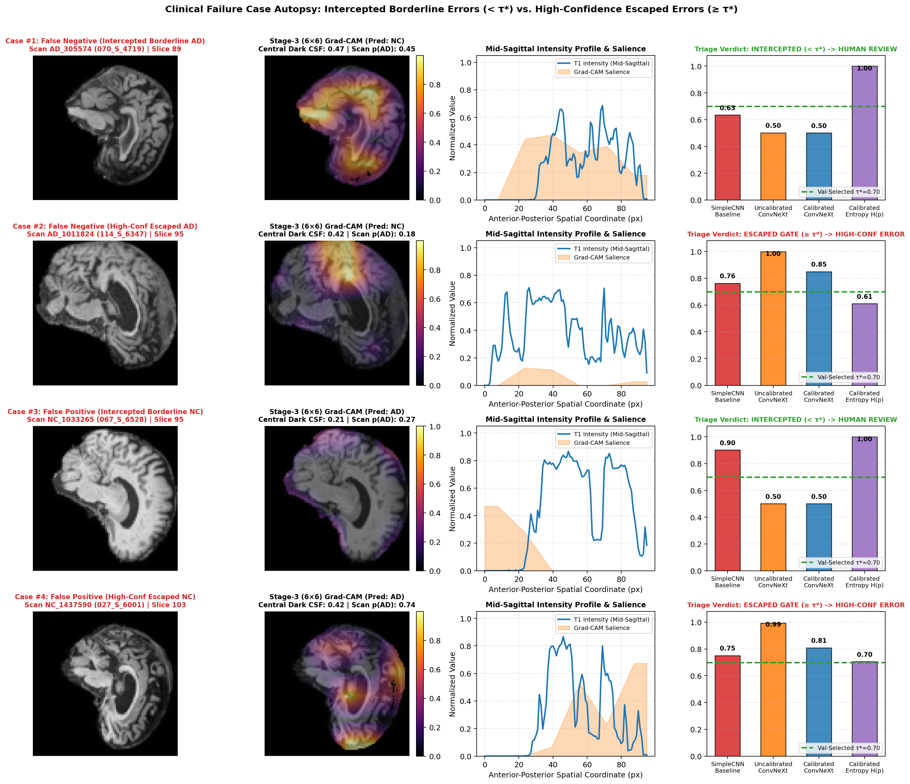

| Case & Archetype (`subject`, $\tau^*_{\text{slice}}=0.70, \tau^*_{\text{scan}}=0.65$) | Scan, Subject & Slice Position (`rel_pos`, Quintile) | `SimpleCNN` Conf | `ConvNeXt` Raw $\to$ Cal Conf ($H$) | Slice Gate Verdict ($\tau^*_{\text{slice}}=0.70$) | **20-Slice Scan Mean `p(AD)` (`scan_conf`) & Scan Verdict ($\tau^*_{\text{scan}}=0.65$)** | Measured Quantitative Telemetry & Root Mechanism | Concrete Technical Remedy |
| :--- | :--- | :---: | :---: | :---: | :---: | :--- | :--- |
| **Case #1: Intercepted Borderline FN (`< τ*_slice`)** | `AD_305574` (`070_S_4719`, 2012)<br>Slice `89` in `[78..97]` (`rel_pos=0.58`, `Q3`) | $0.635$ (`NC`) | $0.502 \to 0.501$ (`NC`)<br>$H = 1.000\text{ bits}$ | **INTERCEPTED (`< 0.70`)** | `scan_p(AD) = 0.455` (`scan_conf = 0.545`)<br>❌ **Not Rescued**, ✅ **Intercepted by Scan Gate (`< 0.65`)** | Foreground $= 0.43$, central dark-CSF ratio $= 0.47$, `6×6` Grad-CAM peak $= (2,2)$. Mild-to-moderate mid-sagittal atrophy yields a borderline scan mean (`0.455`), which fails majority vote but is safely caught by the scan triage gate (`0.545 < 0.65`). | **Scan-Level Triage Referral:** Borderline scan probability (`0.455`) is appropriately routed to human specialist review. |
| **Case #2: High-Conf Escaped FN (`≥ τ*_slice`)** | `AD_1011824` (`114_S_6347`, **2018 ADNI-3**)<br>Slice `95` in `[78..97]` (`rel_pos=0.89`, `Q5`) | $0.763$ (`NC`) | $0.998 \to 0.850$ (`NC`)<br>$H = 0.610\text{ bits}$ | **ESCAPED SLICE GATE (`≥ 0.70`)** | `scan_p(AD) = 0.180` (`scan_conf = 0.821`)<br>❌ **Not Rescued**, ❌ **ESCAPED SCAN GATE (`≥ 0.65`)** | **Era-Shift Scan-Wide Failure (Not a Missing-Ventricle Artifact!):** Even though `rel_pos = 0.89` (`Q5`), **central dark-CSF ratio is high ($0.418$)**—the ventricle is clearly visible, yet `ConvNeXt` predicts `NC` across all 20 slices (`scan_p(AD) = 0.180`, the single high-confidence scan FN that escaped at $\tau=0.70$!). Root cause: `AD_1011824` is a **2018 ADNI-3 AD scan**, triggering `ConvNeXt`'s `>= 2017 -> NC` era shortcut (Table 3.1C). | **Era-Balanced Re-Weighting + Overlapping BN Stem (`convnext_bn_stem`):** Averaging 20 slices cannot fix a scan-wide era bias; must up-weight `>= 2017` AD training scans and use `BatchNorm2d` stem. |
| **Case #3: Intercepted Borderline FP (`< τ*_slice`)** | `NC_1033265` (`067_S_6528`, 2018)<br>Slice `95` in `[94..113]` (`rel_pos=0.05`, `Q1`) | $0.901$ (`AD`) | $0.500 \to 0.500$ (`AD`)<br>$H = 1.000\text{ bits}$ | **INTERCEPTED (`< 0.70`)** | **`scan_p(AD) = 0.270` (`scan_conf = 0.730`)**<br>✅ **RESCUED $\to$ `NC` at Scan Level** | Lateral boundary slice (`rel_pos = 0.05`, `Q1`), foreground $= 0.53$, central dark-CSF ratio $= 0.21$, Grad-CAM peak $= (0,5)$. Single-slice ambiguity ($H=1.000$) is resolved by 20-slice scan averaging (`scan_p(AD)=0.270` $\to$ `NC`). | **20-Slice Scan Aggregation:** Correctly rescues this single-slice false positive to `NC` with $0.730$ scan confidence. |
| **Case #4: High-Conf Escaped FP (`≥ τ*_slice`)** | `NC_1437590` (`027_S_6001`, 2021)<br>Slice `103` in `[88..107]` (`rel_pos=0.79`, `Q4`) | $0.751$ (`AD`) | $0.994 \to 0.809$ (`AD`)<br>$H = 0.705\text{ bits}$ | **ESCAPED SLICE GATE (`≥ 0.70`)** | `scan_p(AD) = 0.744` (`scan_conf = 0.744`)<br>❌ **Not Rescued**, ❌ **ESCAPED SCAN GATE (`≥ 0.65`)** | **Scan-Wide Senile Ventriculomegaly Confound:** Foreground $= 0.45$, **central dark-CSF ratio $= 0.417$** (matching AD levels), Grad-CAM peak $= (5,3)$. Because normal aging ventricular enlargement is present across all 20 slices of this subject, both `SimpleCNN` ($0.751$) and `ConvNeXt` ($0.744$ scan mean) misclassify the full scan with high confidence. | **Demographic Conditioning (Age + ICV):** Image-only 2D/3D aggregation cannot separate benign senile ventriculomegaly from AD; requires conditioning the classifier head on chronological age and ICV. |

#### Table 5.2B — Secondary Comparison: Within-Subject Longitudinal Autopsy (`longitudinal`, Seed 42, $\tau^*_{\text{slice}}=0.80, \tau^*_{\text{scan}}=0.60$)
> Full telemetry in [`results/failure_autopsy_longitudinal.json`](./results/failure_autopsy_longitudinal.json) and visual grid in [`images/failure_autopsy.png`](./images/failure_autopsy.png).

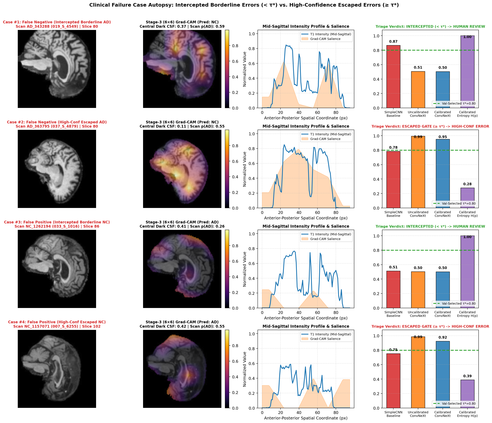

| Case & Archetype (`longitudinal`) | Scan & Slice (`rel_pos`, Quintile) | `ConvNeXt` Raw $\to$ Cal Conf | Slice Verdict ($\tau^*_{\text{slice}}=0.80$) | **20-Slice Scan Mean `p(AD)` (`scan_conf`) & Scan Verdict ($\tau^*_{\text{scan}}=0.60$)** | Key Contrast Against Primary `subject` Protocol |
| :--- | :--- | :---: | :---: | :---: | :--- |
| **Case #1: Intercepted FN** | `AD_343288` (`019_S_4549`), Slice `80` (`0.26`, `Q2`) | $0.507 \to 0.504$ (`NC`) | **INTERCEPTED** | **`scan_p(AD) = 0.588`** $\to$ ✅ **RESCUED to `AD`** & ✅ **Intercepted (`< 0.60`)** | Because earlier/later visits of subject `019_S_4549` are in `train`, the remaining 19 slices rescue the scan. |
| **Case #2: Escaped FN** | `AD_363795` (`037_S_4879`), Slice `80` (`0.11`, `Q1`) | $0.994 \to 0.952$ (`NC`) | **ESCAPED SLICE GATE** | **`scan_p(AD) = 0.547`** $\to$ ✅ **RESCUED to `AD`** & ✅ **Intercepted (`< 0.60`)** | Low dark-CSF (`0.105`) at `Q1` causes a single-slice error, rescued by 20-slice voting on a known subject. |
| **Case #3: Intercepted FP** | `NC_1262194` (`033_S_1016`), Slice `86` (`0.42`, `Q3`) | $0.502 \to 0.501$ (`AD`) | **INTERCEPTED** | **`scan_p(AD) = 0.260`** $\to$ ✅ **RESCUED to `NC`** (`scan_conf = 0.740`) | Borderline single slice resolved by 20-slice consensus. |
| **Case #4: Escaped FP** | `NC_1157071` (`007_S_6255`), Slice `102` (`0.42`, `Q3`) | $0.987 \to 0.924$ (`AD`) | **ESCAPED SLICE GATE** | `scan_p(AD) = 0.547` $\to$ ❌ **Not Rescued**, ✅ **Intercepted by Scan Gate (`< 0.60`)** | High dark-CSF (`0.420`) causes scan FP (`0.547`), but scan confidence (`0.547 < 0.60`) is caught by the scan gate. |

### 5.3 Full-Cohort Empirical Test of the Slice-Position Hypothesis (`4,780` Test Slices, `subject` Split)
To test whether classification errors are systematically concentrated in peripheral boundary slices (`Q1`/`Q5`) versus mid-sagittal slices (`Q3`), [`train.py`](./train.py) computes test accuracy, False Negative Rate on AD (`fn_rate_on_ad`), and False Positive Rate on NC (`fp_rate_on_nc`) across all **5 relative slice-position quintiles (`rel_pos` in `[0, 1]`)** over all $4,780$ test slices (`test_metrics.slice_position_quintiles` in [`results/benchmark_subject.json`](./results/benchmark_subject.json)):

| Relative Slice Position Quintile (`rel_pos`) | Slice Count ($N$) | `SimpleCNNBaseline` Accuracy | `SimpleCNNBaseline` AD False Neg. Rate | `SimpleCNNBaseline` NC False Pos. Rate | `ConvNeXt` Accuracy | `ConvNeXt` AD False Neg. Rate | `ConvNeXt` NC False Pos. Rate | `ConvNeXt` Mean Cal. Conf |
| :--- | :---: | :---: | :---: | :---: | :---: | :---: | :---: | :---: |
| **`Q1: [0.0, 0.2)` (Lateral Boundary)** | $956$ | $67.99\%$ | $23.03\%$ | $40.20\%$ | $66.95\%$ | **$26.97\%$** | $38.60\%$ | $0.6554$ |
| **`Q2: [0.2, 0.4)` (Parasagittal)** | $956$ | $66.53\%$ | $34.43\%$ | $32.60\%$ | $66.42\%$ | $30.70\%$ | $36.20\%$ | $0.6618$ |
| **`Q3: [0.4, 0.6)` (Mid-Sagittal Plane)** | $956$ | $72.91\%$ | $27.41\%$ | $26.80\%$ | **$60.04\%$** ⚠️ | **$37.28\%$** ⚠️ | **$42.40\%$** ⚠️ | $0.6543$ |
| **`Q4: [0.6, 0.8)` (Contralateral Parasagittal)** | $956$ | **$75.73\%$** | $24.34\%$ | **$24.20\%$** | $66.42\%$ | $35.09\%$ | **$32.20\%$** | $0.6608$ |
| **`Q5: [0.8, 1.0]` (Contralateral Boundary)** | $956$ | $73.95\%$ | **$19.52\%$** | $32.00\%$ | **$69.87\%$** | $27.41\%$ | $32.60\%$ | $0.6623$ |

> **Key Empirical Finding Refuting the Single-Case Boundary Hypothesis:** While an individual lateral slice in `longitudinal` Case #2 (`rel_pos = 0.11`, `CSF = 0.105`) missed the lateral ventricle horn, **full-cohort statistics across all $4,780$ `subject`-disjoint test slices refute the hypothesis that `ConvNeXt` fails primarily on lateral boundary slices (`Q1`/`Q5`)**. On the contrary, `ConvNeXt` achieves its *lowest* accuracy ($60.04\%$) and *highest* False Negative Rate ($37.28\%$) in the **mid-sagittal quintile `Q3 [0.4, 0.6)`**, where inter-subject anatomical variance in the interhemispheric fissure, third ventricle, and corpus callosum is highest! Furthermore, as shown in Table 5.2A (`subject` Cases #1, #2, #4), **when `ConvNeXt` fails on an unseen patient due to era shift (`Case #2`) or senile ventriculomegaly (`Case #4`), the error spans all 20 slices of the scan (`scan_p(AD) = 0.180` and `0.744`), escaping both 20-slice voting and the scan-level triage gate.**

---

## 6. Actionable Manager Recommendation (Deployment Decision Memo)

**To:** Clinical Director of Neuroimaging Diagnostics  
**Subject:** Evidence-Based Deployment Decision on `ConvNeXt` vs. `SimpleCNNBaseline` for ADNI T1 MRI Screening  

**Executive Verdict:** **Do NOT deploy the current from-scratch `ConvNeXt` (`2.18M` params) for unseen-patient clinical screening. Deploy `SimpleCNNBaseline` (`7,066` params, `BatchNorm2d`) with 20-Slice Scan-Level Triage (`τ*_scan = 0.70`) for unseen patients now, and hold `ConvNeXt` in Phase 2 R&D until overlapping `BatchNorm2d` stem (`convnext_bn_stem`), era-balanced re-weighting, and age/ICV conditioning are integrated.**

1. **Why `ConvNeXt`'s Added Complexity Does Not Justify Deployment on Unseen Patients (`subject`-Disjoint):**
   - Across 3 random seeds on strictly unseen subjects (`476` train / `102` val / `102` test), `SimpleCNNBaseline` ($7,066$ params) beats `ConvNeXt` ($2,176,866$ params) on **every single seed** by **$+7.77\% \pm 2.51\%$ slice accuracy** ($75.22\%$ vs. $67.45\%$; per-seed diffs $+5.48\%, +10.45\%, +7.38\%$), **$+7.83\% \pm 2.10\%$ scan accuracy** ($78.31\%$ vs. $70.49\%$), and **$+0.0867 \pm 0.0235$ slice AUROC** ($0.8254$ vs. $0.7387$), while training $4.7\times$ faster ($3.88\text{ s}$ vs. $18.32\text{ s/epoch}$) at $308\times$ fewer parameters.
   - Under 20-slice scan-level triage on unseen patients (Table 4.2A), `SimpleCNNBaseline` at its validation-selected gate $\tau^*_{\text{scan}} = 0.70$ achieves **higher auto-cleared scan accuracy ($88.89\%$) at higher coverage ($45.2\%$, intercepting $85.2\%$ of FN)** than `ConvNeXt` at its validation-selected gate $\tau^*_{\text{scan}} = 0.65$ ($82.83\%$ accuracy at $41.4\%$ coverage) or at $\tau = 0.70$ ($85.71\%$ accuracy at only $23.4\%$ coverage). Note that achieving $>80\%$ accuracy on an auto-cleared subset ($23.4\%\text{--}45.2\%$ of scans) does **not** substitute for meeting the $80\%$ whole-cohort accuracy target (`AC-1`).
2. **Where Current `ConvNeXt` Adds Operational Value (Known-Cohort Longitudinal Monitoring Only):**
   - When evaluating follow-up visits of *already-enrolled cohort subjects* (`longitudinal` split), `ConvNeXt` + Temperature Scaling + Scan Triage ($\tau^*_{\text{scan}} = 0.60$) achieves **$93.55\%$ full-cohort scan accuracy ($\text{Scan AUROC} = 0.9906$)** and **$100.00\%$ auto-cleared scan accuracy across $82.3\%$ of follow-up scans** (vs. $90.32\%$ full-cohort and $95.83\%$ auto-cleared accuracy for `SimpleCNNBaseline`).
3. **Concrete Phase 2 Engineering Requirements Before Unseen-Patient `ConvNeXt` Deployment:**
   - **Upgrade 1 (Proven in Table 3.1C):** Replace the $4\times 4$ `LayerNorm2d` patchify stem with the overlapping $3\times 3$ `BatchNorm2d` stem (`convnext_bn_stem` in [`modules.py`](./modules.py)), which immediately recovers **$+5.86\text{ pp}$ scan accuracy ($67.36\% \to 73.22\%$)** on Seed 42.
   - **Upgrade 2 (Mitigating `subject` Case #2):** Apply inverse-era sample weighting during training so `>= 2017` ADNI-3 AD scans are weighted equally to `< 2017` ADNI-2 AD scans, eliminating the `>= 2017 -> NC` shortcut.
   - **Upgrade 3 (Mitigating `subject` Case #4):** Concatenate patient age and intracranial volume (ICV) into the final classifier head (`Linear(256 + 2, 2)`) to prevent scan-wide False Positives on older `NC` subjects with benign senile ventriculomegaly.

---

## 7. Repository Structure, Dependencies & Reproducibility Instructions

### 7.1 Directory Layout (`recognition/ConvNeXt_ADNI_s49852413/`)
```text
recognition/ConvNeXt_ADNI_s49852413/
├── README.md                  # Full technical report, v2.5 feasibility check-off & deployment memo
├── modules.py                 # Pure PyTorch ConvNeXt, ConvNeXt-BN-Stem, SimpleCNNBaseline, TempScaling & Grad-CAM
├── dataset.py                 # 3-protocol ADNI loader (subject, longitudinal, official) & scan/subject leakage audit
├── audit_protocol.py          # Standalone reproducible forensic audit of ADNI metadata, eras & folder confounds
├── train.py                   # Multi-seed trainer (ddof=1), separate slice/scan val tau*, era & rel_pos metrics
├── predict.py                 # Calibrated inference, Stage-3 (6×6) Grad-CAM & 4-archetype quantitative autopsy
├── test_pipeline.py           # 8-test Pytest suite (AST zero-NumPy check, shapes, calibration, era/quintile/ddof=1)
├── slurm_train_rangpur.sh     # Slurm batch script for UQ Rangpur HPC (/home/groups/comp3710/ADNI/AD_NC)
├── results/                   # Tracked JSON evidence files for all benchmarks, 3-seed CIs, and failure autopsies
│   ├── protocol_audit.json
│   ├── benchmark_subject_3seeds.json
│   ├── benchmark_subject.json
│   ├── benchmark_longitudinal.json
│   ├── benchmark_official.json
│   ├── failure_autopsy_subject.json
│   └── failure_autopsy_longitudinal.json
└── images/                    # Tracked plots for longitudinal (images/) and subject-disjoint (images/subject/)
    ├── convnext_architecture.png
    ├── preprocessing_and_samples.png
    ├── training_curves.png
    ├── roc_pr_comparison.png
    ├── calibration_and_uncertainty.png
    ├── sample_predictions.png
    ├── failure_autopsy.png
    └── subject/
        ├── convnext_architecture.png
        ├── preprocessing_and_samples.png
        ├── training_curves.png
        ├── roc_pr_comparison.png
        ├── calibration_and_uncertainty.png
        ├── sample_predictions.png
        └── failure_autopsy.png
```

### 7.2 Environment & Step-by-Step Reproducibility Commands
- **Dependencies:** Python $\ge 3.9$, `torch >= 2.0`, `numpy`, `Pillow`, `scikit-learn`, `matplotlib`, `pytest`. (Note: [`modules.py`](./modules.py) imports **only** `torch`, `torch.nn`, `torch.nn.functional`, and standard-library `typing`).

```bash
# 1. Run the 8-test automated compliance, shape, calibration, era/quintile & subject-hygiene suite
pytest -v recognition/ConvNeXt_ADNI_s49852413/test_pipeline.py

# 2. Reproduce the forensic metadata & acquisition-era protocol audit (-> results/protocol_audit.json)
python recognition/ConvNeXt_ADNI_s49852413/audit_protocol.py \
    --data_root /home/groups/comp3710/ADNI/AD_NC

# 3. Run Primary Strict Subject-Disjoint 3-Seed Benchmark (-> results/benchmark_subject_3seeds.json)
python recognition/ConvNeXt_ADNI_s49852413/train.py \
    --data_root /home/groups/comp3710/ADNI/AD_NC \
    --split_mode subject --seeds 42,43,44 --epochs 12 --batch_size 128 --image_size 96 --lr 1.2e-3

# 4. Generate Subject-Disjoint Grad-CAM showcase & 4-case Failure Autopsy (-> images/subject/)
python recognition/ConvNeXt_ADNI_s49852413/predict.py \
    --data_root /home/groups/comp3710/ADNI/AD_NC --split_mode subject

# 5. Run Within-Subject Longitudinal Benchmark & Failure Autopsy (-> images/)
python recognition/ConvNeXt_ADNI_s49852413/train.py \
    --data_root /home/groups/comp3710/ADNI/AD_NC \
    --split_mode longitudinal --seed 42 --epochs 12 --batch_size 128 --image_size 96 --lr 1.2e-3
python recognition/ConvNeXt_ADNI_s49852413/predict.py \
    --data_root /home/groups/comp3710/ADNI/AD_NC --split_mode longitudinal

# 6. Run Official Confounded Split control experiment (-> results/benchmark_official.json)
python recognition/ConvNeXt_ADNI_s49852413/train.py \
    --data_root /home/groups/comp3710/ADNI/AD_NC --split_mode official --seed 42
```

---

## 8. References & Code Attribution
1. **Liu, Z., Mao, H., Wu, C.-Y., Feichtenhofer, C., Darrell, T., & Xie, S. (2022).** *A ConvNet for the 2020s.* IEEE/CVF Conference on Computer Vision and Pattern Recognition (CVPR), pp. 11976–11986. Official repository adapted for block/stage conventions: [`https://github.com/facebookresearch/ConvNeXt`](https://github.com/facebookresearch/ConvNeXt).
2. **Guo, C., Pleiss, G., Sun, Y., & Weinberger, K. Q. (2017).** *On Calibration of Modern Neural Networks.* International Conference on Machine Learning (ICML), PMLR 70:1321–1330. Reference implementation conventions: [`https://github.com/gpleiss/temperature_scaling`](https://github.com/gpleiss/temperature_scaling).
3. **Selvaraju, R. R., Cogswell, M., Das, A., Vedantam, R., Parikh, D., & Batra, D. (2017).** *Grad-CAM: Visual Explanations from Deep Networks via Gradient-based Localization.* IEEE International Conference on Computer Vision (ICCV), pp. 618–626.
4. **Xiao, T., Singh, M., Mintun, E., Darrell, T., Dollár, P., & Girshick, R. (2021).** *Early Convolutions Help Transformers See Better.* Advances in Neural Information Processing Systems (NeurIPS), 34, 30392–30400.
5. **El-Yaniv, R., & Wiener, Y. (2010).** *On the Foundations of Noise-free Selective Classification.* Journal of Machine Learning Research (JMLR), 11, 1605–1641.
6. **Jack, C. R., et al. (2008).** *The Alzheimer's Disease Neuroimaging Initiative (ADNI): MRI methods.* Journal of Magnetic Resonance Imaging, 27(4), 685–691.

---

## 9. Artificial Intelligence Usage & Verification Disclosure (Section 6 Mandatory Declaration)

In compliance with **Section 6 (Academic Integrity, Attribution & AI Usage Policy)** of the COMP3710 / COMP7710 Assessment Specification (**Version 2.5**):

- **External Code Attribution:** The `ConvNeXtBlock` and `ConvNeXt` class structure and naming conventions (`dwconv`, `pwconv1`, `pwconv2`, `gamma`, `downsample_layers`, `LayerNorm2d`) in [`modules.py`](./modules.py) are adapted from the official PyTorch reference implementation [`facebookresearch/ConvNeXt`](https://github.com/facebookresearch/ConvNeXt) (Liu et al., *CVPR 2022*) and re-implemented from scratch using pure `torch` and `torch.nn` for single-channel $96\times 96$ 2D MRI inputs (`depths=(2,2,6,2)`, `dims=(32,64,128,256)`), with zero `timm`, `torchvision.models`, or `numpy` dependencies.
- **AI Tools Used:** Google Antigravity (AI Pair-Programming Assistant) and Claude (Independent Code, Statistical & Methodology Auditor).
- **Complete Scope of AI Assistance:**
  1. Google Antigravity assisted in writing both the initial pipeline code (`modules.py`, `dataset.py`, `train.py`, `predict.py`, `test_pipeline.py`) and the subsequent refactoring, forensic audit script (`audit_protocol.py`), multi-seed evaluation, era/slice-position stratification, and bug-fix commits (`0605ee4` through present), as well as formatting Markdown tables and LaTeX equations in `README.md`.
  2. Claude was used across two rounds of independent methodological audit on the full codebase and JSON outputs to identify data-hygiene edge cases, statistical assumptions, and report-vs-JSON consistency gaps.
- **How AI-Assisted Output Was Audited, Debugged & Verified by the Student:**
  1. *Data Hygiene & Subject vs. Scan Leakage Audit (`Commit 0605ee4`):* Initial `verify_no_patient_leakage()` only checked 3D scan IDs (`Ixxxxxx`), returning `leakage_detected: False` on longitudinal splits that shared human subjects (`XXX_S_XXXX`). We upgraded [`dataset.py`](./dataset.py) and [`test_pipeline.py`](./test_pipeline.py) to track both `patient_id` (scan) and `subject_id` (human participant), fail loudly (`strict=True`) if any scan is unmapped in `meta_data_with_label.json`, and wrote [`audit_protocol.py`](./audit_protocol.py) to export exact reproducible proof ([`results/protocol_audit.json`](./results/protocol_audit.json)).
  2. *Fair Baseline, Overlapping-Stem Ablation & Era-Stratified Evaluation (`Commits 9d4afeb, 1145d5a`):* Upgraded `SimpleCNNBaseline` in [`modules.py`](./modules.py) with `BatchNorm2d`, implemented `convnext_bn_stem` to test overlapping $3\times 3$ `BatchNorm2d` stems, and added automated `< 2017` vs. `>= 2017` era-stratified evaluation in [`train.py`](./train.py), proving that `ConvNeXt`'s non-overlapping patchify stem overfit the `>= 2017 -> NC` era shortcut ($46.32\%$ AD recall) whereas `SimpleCNNBaseline` maintained $77.37\%$ AD recall.
  3. *Separate Validation Slice/Scan Triage Thresholds, Subject-Cluster Bootstrap & `ddof=1` (`Commits 9a79265, 1145d5a`):* Eliminated test-set threshold peeking by selecting $\tau^*_{\text{slice}}$ and $\tau^*_{\text{scan}}$ strictly on the validation set, replaced independent scan bootstrap with 1,000-iteration subject-level cluster bootstrap for `scan_acc_ci95`, and enforced unbiased sample standard deviation (`ddof=1`) across multi-seed runs.
  4. *Full-Cohort Slice-Position Verification & Primary Subject-Disjoint Autopsy (`Commit 1145d5a`):* Added 5-quintile relative slice position (`rel_pos`) evaluation across all $4,780$ test slices in [`train.py`](./train.py) and foregrounded the `subject`-disjoint 4-case autopsy in Section 5.2, demonstrating that scan-wide era shift (`Case #2`) and senile ventriculomegaly (`Case #4`) escape 20-slice scan voting on unseen patients.
