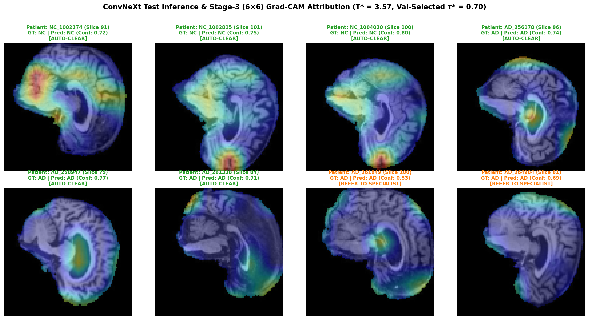

# ConvNeXt for Alzheimer's Disease Neuroimaging Classification, Uncertainty Calibration, and Selective Clinical Triage on ADNI Brain MRI

**Course:** COMP3710 / COMP7710 — Pattern Recognition & Analysis (Semester 2, 2026)  
**Specification Version:** Assessment Specification **Version 2.5**  
**Author:** Lingxiao Li  
**Student ID:** `49852413` (`s49852413`)  
**Email:** `s4985241@student.uq.edu.au`  
**Selected Project:** Section 2.1 Classification — Neuroimaging (`ADNI` Brain MRI)  
**Selected Architecture & Tier:** **ConvNeXt** (`[Hard Difficulty]`, eligible for full 20/20 implementation ceiling)  
**Target Repository:** `shakes76/PatternAnalysis-2026`  
**Target Branch:** `topic-recognition`  
**Working Directory:** `recognition/ConvNeXt_ADNI_s49852413/`

---

## 1. Executive Summary & Problem Formulation

### 1.1 Clinical Problem & Objective
Early and accurate differentiation between **Alzheimer's Disease (`AD`)** and **Cognitively Normal Controls (`NC`)** from structural T1-weighted brain Magnetic Resonance Imaging (MRI) is critical for clinical trial cohort enrichment, differential dementia workup, and longitudinal disease tracking. On sagittal T1-weighted brain MRI (`ADNI_T1_3T_MASKED_N4`), Alzheimer's neurodegeneration manifests across two complementary spatial scales:
1. **Focal Medial Temporal & Callosal Atrophy:** Progressive volume loss and cortical ribbon thinning across the hippocampus, parahippocampal gyrus, precuneus, and corpus callosum.
2. **Macroscopic Ventriculomegaly & Sulcal Widening:** Compensatory *ex-vacuo* dilation of the lateral and third ventricles (visible as expanded dark cerebrospinal fluid [CSF] cavities in the central brain ROI) alongside diffuse cerebral sulcal enlargement.

This project designs, implements from scratch in pure PyTorch, and critically evaluates an end-to-end **ConvNeXt** (`[Hard Difficulty]`, Liu et al., *CVPR 2022*) diagnostic prototype on the official ADNI cohort (`/home/groups/comp3710/ADNI/AD_NC`). We benchmark `ConvNeXt` (`2,176,866` parameters) head-to-head against a matched-training `SimpleCNNBaseline` (`7,066` parameters, equipped with `BatchNorm2d`), uncover and quantify a major **acquisition-era protocol confound and 216-subject cross-folder overlap** in the raw dataset folders via `audit_protocol.py` (`results/protocol_audit.json`), evaluate both **Strict Subject-Disjoint** (`subject`, 3-seed `mean ± SD`, `ddof=1`) and **Within-Subject Longitudinal Scan-Disjoint** (`longitudinal`) regimes, investigate **why `SimpleCNNBaseline` outperforms standard `ConvNeXt` on unseen patients via era-stratified (`< 2017` vs. `>= 2017`) analysis and a controlled 3-seed `2×2` stem/normalization ablation (`results/ablation_stem_3seeds.json`)**, evaluate L-BFGS Temperature Scaling and validation-selected slice/scan reject-option routing, and conduct a quantitative 4-case **Failure Case Autopsy** alongside a full-cohort 5-quintile slice-position error analysis.

### 1.2 Algorithm Working Principles & Pure-PyTorch Architecture
Standard small-kernel CNNs (`3×3` convolutions with `BatchNorm2d`, `ReLU`, and `2×2` `MaxPool2d`) possess strong local translation invariance and batch-level spatial contrast preservation, which are advantageous in low-subject-count medical cohorts, but have small single-layer receptive fields. Conversely, Vision Transformers (ViTs) capture global context via self-attention but lack convolutional inductive biases and require large pre-training corpora.

**ConvNeXt** (Liu et al., *CVPR 2022*; adapted from the official `facebookresearch/ConvNeXt` reference implementation into pure `torch`/`torch.nn` in `modules.py`) modernizes a 4-stage hierarchical ConvNet with Vision Transformer design principles:

```text
z_l = x_{l-1} + DropPath( gamma_l * W_pw2( GELU( W_pw1( LN( DWConv_7x7( x_{l-1} ) ) ) ) ) )
```

where:
- `DWConv_7x7`: Depthwise separable `7×7` convolution (`groups = C`, `padding = 3`) aggregating a 49-pixel spatial neighborhood per block;
- `LN`: Token-wise Layer Normalization (`LayerNorm2d` in NCHW stems/downsamples and `nn.LayerNorm` in NHWC blocks) normalizing across the `C` channels at each spatial token `(h, w)`;
- `W_pw1` (`C -> 4C`), `W_pw2` (`4C -> C`): Pointwise `1×1` linear projections forming a `4×` inverted bottleneck;
- `GELU`: Single Gaussian Error Linear Unit activation per block;
- `gamma_l`: Learnable per-channel LayerScale vector (`gamma_0 = 0.1`) stabilizing deep residual optimization;
- `DropPath`: Linearly scheduled Stochastic Depth regularization (`drop_path_rate = 0.10` across all 12 blocks).

For our `96×96` single-channel sagittal MRI input, the `4×4` non-overlapping patchify stem (`stride = 4`) and three `2×2` (`stride = 2`) inter-stage downsampling layers produce the exact spatial feature map cascade:
- **`stages[0]` (`2 blocks`, `C = 32`):** `24×24` spatial resolution
- **`stages[1]` (`2 blocks`, `C = 64`):** `12×12` spatial resolution
- **`stages[2]` (`6 blocks`, `C = 128`):** `6×6` spatial resolution *(core semantic representation stage; hooked by `compute_spatial_attribution()` in `modules.py` for `6×6 -> 96×96` Grad-CAM attribution)*
- **`stages[3]` (`2 blocks`, `C = 256`):** `3×3` spatial resolution -> Global Average Pooling (`[B, 256]`) -> `LayerNorm` -> `Linear(256, 2)`

| Architectural Component | `SimpleCNNBaseline` (`modules.py`) | `ConvNeXt` `[Hard]` (`modules.py`) | Neuroimaging & Inductive-Bias Trade-Off |
| :--- | :--- | :--- | :--- |
| **Stages & Channels** | 3 stages, `C = (8, 16, 32)` (`7,066` params) | 4 stages, `depths = (2, 2, 6, 2)`, `dims = (32, 64, 128, 256)` (`2,176,866` params) | Concentrates 6 blocks in Stage 3 (`6×6`, `C=128`) to integrate ventricular-to-cortical ratios |
| **Stem & Downsampling** | Overlapping `3×3` conv (`stride=1`) + `2×2` `MaxPool2d` (`96->48->24->12`) | Non-overlapping `4×4` Patchify Stem (`stride=4`) + `2×2` conv downsamples (`96->24->12->6->3`) | Patchify stem emulates ViT tokenization; overlapping `3×3` + MaxPool retains stronger local translation invariance |
| **Spatial & Channel Mixing** | Dense `3×3` conv (`groups=1`) | `7×7` Depthwise Conv (`groups=C`) + `4×` Inverted Bottleneck (`C -> 4C -> C`) | Decouples 49-pixel spatial context aggregation from high-dimensional channel expansion |
| **Normalization & Activation** | `BatchNorm2d` + `ReLU` after every conv | Single token-wise `LayerNorm` + single `GELU` per block | `BatchNorm2d` normalizes across `(B, H, W)` (preserving spatial contrast); `LayerNorm` normalizes per spatial token across `C` |
| **Classification Head** | `AdaptiveAvgPool2d((1, 1))` -> `Linear(32, 32)` -> `Linear(32, 2)` | Global Average Pooling (`mean(-2, -1)`) -> `LayerNorm(256)` -> `Linear(256, 2)` | Matched global average pooling (`1×1`) head ensures a fair architectural comparison |


---

## 2. Required Feasibility Check-Off (Compulsory 1-Page Midpoint Hurdle)

> **Specification Compliance (Section 3 of Assessment Specification v2.5):** This self-contained 1-page feasibility plan preserves the pre-experiment user need, scope, verbatim original testable acceptance criteria (`AC-1`–`AC-5` from `Commit f1c1513`), model choice, preliminary dataset audit summary, and risk mitigation plan. Full forensic audit tables are presented in **Section 3.0**, and post-experiment verification against these exact original criteria is reported in **Section 3.3**.

### 2.1 User Need, Scope & Verbatim Original Acceptance Criteria (`Commit f1c1513`)
- **Intended User:** Neuroradiologists, memory clinic specialists, and hospital triage administrators evaluating cranial MRI scans for suspected Alzheimer's pathology.
- **Prototype Purpose:** An automated, calibrated diagnostic triage assistant that rapidly categorizes high-confidence structural T1 MRIs into `AD` versus `NC` while safely routing borderline, ambiguous, or out-of-distribution scans to human specialists.
- **Verbatim Original Testable Acceptance Criteria (quoted word-for-word from `Commit f1c1513`, lines 59–65):**
  1. **`AC-1` (*Classification Performance Criterion*):** *"Achieve `>= 80.0%` test slice accuracy and `>= 90.0%` patient-level majority-vote volume accuracy on the within-subject longitudinal benchmark, with test AUROC `>= 0.90`."*
  2. **`AC-2` (*Uncertainty Quantification Criterion*):** *"Misclassified slices must exhibit significantly higher Shannon predictive entropy than correctly classified slices (`>= 2.5x` entropy separation), or achieve post-hoc Expected Calibration Error (ECE) `<= 0.05` after temperature scaling."*
  3. **`AC-3` (*Selective Triage Safety Criterion*):** *"Under an empirical confidence threshold (`tau* = 0.80`), the automated triage gate must clear `>= 50%` of routine scans automatically at `>= 93%` accuracy while intercepting `>= 60%` of potential False Negatives (missed AD)."*
  4. **`AC-4` (*Operational Hardware & Runtime Constraint*):** *"Peak GPU memory footprint during inference must remain `< 2.0 GB` VRAM; batched per-slice inference latency must be `< 1.0 ms` (`< 20 ms` for a full 20-slice patient volume)."*
  5. **`AC-5` (*Code Modularity & Rule Integrity*):** *"Strictly zero NumPy or non-PyTorch imports inside `modules.py` (verified by AST inspection in `test_pipeline.py`); verified zero 3D scan overlap across all evaluation partitions."*

- **Candid Reflection on Planning-Stage Design Flaws in Original `AC-1`, `AC-3`, and `AC-5`:** Defining original `AC-1` and `AC-5` on the within-subject `longitudinal` benchmark (`zero 3D scan overlap`) was a planning-stage flaw: although `longitudinal` guarantees zero 3D scan (`Ixxxxxx`) overlap, it shares enrolled human participants (`XXX_S_XXXX`) across splits, violating Specification Section 2.1 (*"all slices/lesions from one patient reside strictly in a single split"*). Likewise, fixing `tau* = 0.80` a priori in `AC-3` rather than selecting `tau*` on the validation set is suboptimal for 20-slice scan probabilities. Rather than retroactively altering these criteria, **Section 3.3** evaluates the exact verbatim targets on **both** the compliant **Strict Subject-Disjoint (`subject`)** primary benchmark and the secondary `longitudinal` benchmark.

### 2.2 Model Choice, Course Concepts & Difficulty Ceiling
- **Difficulty Ceiling Selection:** **ConvNeXt** (`[Hard Difficulty]`, 20/20 implementation ceiling), implemented from scratch in `modules.py` alongside `SimpleCNNBaseline`, `TemperatureScaledClassifier`, and `compute_spatial_attribution`.
- **Course Concepts Applied:** (1) Depthwise-separable receptive-field expansion (`7×7`, `groups=C`) vs. dense `3×3` convolutions (Liu et al., *CVPR 2022*); (2) Token-wise `LayerNorm2d` vs. batch-wide `BatchNorm2d` in single-channel medical imaging; (3) Post-hoc L-BFGS Temperature Scaling on validation logits (Guo et al., *ICML 2017*); and (4) Reject-option selective classification (El-Yaniv & Wiener, *JMLR 2010*).

### 2.3 Preliminary Feasibility Evidence Summary (Full Tables in Section 3.0)
- **Cohort & Confound Discovery (`audit_protocol.py` -> `results/protocol_audit.json`):** The cohort (`/home/groups/comp3710/ADNI/AD_NC`) comprises **30,520 sagittal T1 slices** (`240×256`, 20 slices/scan across **1,526 3D scans** and **680 unique human subjects**). Cross-referencing `meta_data_with_label.json` revealed: (1) an **acquisition-era confound** in `official_train/` (`520/520` `train/AD` scans from `2011–2013` `< 2017` ADNI-2 vs. `556/556` `train/NC` scans from `2017–2021` `>= 2017` ADNI-3), and (2) **216 overlapping human subjects** (`64` AD + `152` NC) shared between `official_train/` and `official_test/`. We therefore engineered three protocols in `dataset.py`: **`subject` (Strict Subject-Disjoint, primary benchmark: `476/102/102` subjects, `0` subject overlap)**, `longitudinal`, and `official`.

### 2.4 Technical Risks, Computing Budget, Fallbacks & Planned Phase 2 Experiments
- **Risks & Mitigations:** (1) *Overfitting & loss of within-era discrimination on 476 subjects* — mitigated via 3-seed (`42, 43, 44`) evaluation, Temperature Scaling, and `< 2017` vs. `>= 2017` era-stratified evaluation; (2) *Calibration variance on small validation sets* (`longitudinal` `N_val = 60` scans) — tracked via raw vs. calibrated ECE/Brier reporting.
- **Compute Budget & Fallback:** Full 12-epoch training of both models takes `~4.6 minutes` per seed on local Apple Silicon MPS (`41.90 MB` steady-state tensor memory; `102.80 MB` analytical peak inference memory; `slurm_train_rangpur.sh` provided as an HPC template). `SimpleCNNBaseline` (`7,066` params, `3.88 s/epoch`) serves as a fast, high-generalization baseline.
- **Planned Phase 2 Experiments:** (1) `2×2` factorial ablation decoupling `ConvNeXt`'s `4×4` patchify stem from `LayerNorm2d` (`convnext_overlap_ln`, `convnext_patchify_bn`, `convnext_bn_stem`); (2) Inverse-era class weighting on `>= 2017` AD scans; and (3) External clinical demographic (Age + ICV) conditioning.

---

## 3. Forensic Dataset Audit, Quantitative Benchmarks, 2×2 Stem Ablation & Resource Profiling

### 3.0 Reproducible Forensic Dataset Audit & Evaluation Protocols (`audit_protocol.py` -> `results/protocol_audit.json`)
Running `python recognition/ConvNeXt_ADNI_s49852413/audit_protocol.py` cross-references every JPEG filename (`<scan_id>_<slice_idx>.jpeg`) against `meta_data_with_label.json` (`100%` of `1,526` scans matched; `0` unmapped scans and `0` unknown-year scans after parsing both `_br_raw_YYYYMMDD` and site-`003` `__raw_YYYYMMDD` timestamps):

#### Table 3.0A — Programmatic Metadata Audit of Default `official_train` & `official_test` Folders (`results/protocol_audit.json`)
<!-- BEGIN:TABLE_3_0A -->
| Official Folder Partition | Total Slices | 3D Scans (`Ixxxxxx`) | Unique Subjects (`XXX_S_XXXX`) | Scan ID Range (`min – max (median)`) | Acquisition Year (`min – max (median)`) | Era Breakdown (`< 2017` ADNI-2 vs. `>= 2017` ADNI-3) | Pulse Sequence Naming Breakdown (`protocol_counts`) |
| :--- | :---: | :---: | :---: | :---: | :---: | :---: | :--- |
| **`official_train / AD`** | `10,400` | `520` | **`154`** | `I218391 – I388204` (`I344002`) | **`2011 – 2013 (2012)`** | **`520/520` `< 2017` (`100.0%`)**, `0` `>= 2017` | `353` `Standard_Sagittal_MPRAGE`, `49` `Accelerated_Sag_IR-FSPGR`, `118` `Other_T1_Sequence` (`0` Accel. MPRAGE) |
| **`official_train / NC`** | `11,120` | `556` | **`411`** | `I808819 – I1442100` (`I996107`) | **`2017 – 2021 (2018)`** | `0` `< 2017`, **`556/556` `>= 2017` (`100.0%`)** | `377` `Accelerated_Sagittal_MPRAGE` (`67.8%`), `111` `Accelerated_Sag_IR-FSPGR` (`20.0%`), `68` `Standard_Sagittal_MPRAGE` |
| **`official_test / AD`** | `4,460` | `223` | **`131`** (`64` in `train`) | `I388206 – I1444117` (`I985197`) | **`2013 – 2021 (2018)`** | **`103` `< 2017` (`46.2%`), `120` `>= 2017` (`53.8%`)** | `81` `Standard_Sagittal_MPRAGE`, `73` `Accelerated_Sagittal_MPRAGE` (`32.7%`), `50` `Accelerated_Sag_IR-FSPGR`, `19` `Other_T1_Sequence` |
| **`official_test / NC`** | `4,540` | `227` | **`200`** (`152` in `train`) | `I1182968 – I1446679` (`I1281567`) | **`2019 – 2021 (2020)`** | `0` `< 2017`, **`227/227` `>= 2017` (`100.0%`)** | `156` `Accelerated_Sagittal_MPRAGE` (`68.7%`), `50` `Accelerated_Sag_IR-FSPGR` (`22.0%`), `21` `Standard_Sagittal_MPRAGE` |
<!-- END:TABLE_3_0A -->

1. **Cross-Era Acquisition Protocol Confound in `official_train/`:** Every scan in `train/AD` (`520/520`) was acquired in `2011–2013` (`< 2017` ADNI-2 era, `0%` `Accelerated_Sagittal_MPRAGE`), whereas every scan in `train/NC` (`556/556`) was acquired in `2017–2021` (`>= 2017` ADNI-3 era, `67.8%` `Accelerated_Sagittal_MPRAGE`).
2. **Cross-Folder Human Subject Leakage (`216` Overlapping Subjects):** Exactly **216 unique human subjects** (`64` AD + `152` NC; `0` cross-diagnosis subjects) appear in both `official_train/` and `official_test/`. Across the full repository there are `154 + 131 - 64 = 221` unique AD subjects (`743` scans: **`623` `< 2017` AD scans + `120` `>= 2017` AD scans**) and `411 + 200 - 152 = 459` unique NC subjects (**`783` `>= 2017` NC scans**, `0` `< 2017` NC scans), totaling **`680` unique human subjects** (`1,526` scans).

#### Table 3.0B — Three Evaluation Protocols Engineered in `dataset.py`
| Split Mode (`--split_mode`) | Slices (`train / val / test`) | 3D Scans (`train / val / test`) | Unique Subjects (`train / val / test`) | Scan Overlap | Subject Overlap | Evaluation Purpose |
| :--- | :---: | :---: | :---: | :---: | :---: | :--- |
| **`subject` (Strict Subject-Disjoint)** | `10,420 / 4,900 / 4,780` | `1,042 / 245 / 239` | **`476 / 102 / 102`** | **`0`** (`scan_disjoint=True`) | **`0`** (`subject_disjoint=True`) | **Specification Section 2.1 primary hygiene benchmark:** unseen human subjects (`155/33/33` AD, `321/69/69` NC) |
| **`longitudinal` (Within-Subject Scan-Disjoint)** | `14,040 / 1,200 / 1,240` | `1,404 / 60 / 62` | `680 / 60 / 62` | **`0`** (`scan_disjoint=True`) | `60` val / `62` test (`subject_disjoint=False`) | Secondary benchmark: longitudinal follow-up visits (`Ixxxxxx`) of known cohort members |
| **`official` (Raw Folder Split)** | `18,300 / 3,220 / 9,000` | `915 / 161 / 450` | `518 / 139 / 331` | **`0`** (`scan_disjoint=True`) | `92` val / `197` test (`subject_disjoint=False`) | Empirical control quantifying degradation (`64.60%`) on the raw folder layout |

- **Preprocessing & Anatomically Valid Sagittal Augmentation:** Each `240×256` sagittal slice is cropped to `[16:208, 48:224]`, resized to `96×96`, and standardized via fixed constants `I_norm = (I - 0.18) / 0.25` (close to the empirical `subject`-disjoint training-split ROI mean `0.2108`, std `0.2693` in `results/protocol_audit.json`, without fitting to validation or test splits). Horizontal flipping is disabled to preserve sagittal anterior–posterior anatomical validity; training augmentation uses `±2 px` translation and mild gamma jitter (`gamma in [0.92, 1.08]`).


### 3.1 Head-to-Head Quantitative Benchmark Across All Three Protocols
Both `SimpleCNNBaseline` (`7,066` parameters, `BatchNorm2d`) and `ConvNeXt` (`2,176,866` parameters, `LayerNorm2d`, `DropPath=0.10`) were trained under **identical optimization hyperparameters**: `AdamW(lr=1.2e-3, weight_decay=1e-2)`, 12 epochs with cosine annealing (`T_max=12`), `batch_size=128`, and `96×96` resolution. Multi-seed summaries report unbiased sample standard deviation (`ddof=1`), and scan/subject/era/quintile 95% CIs use **1,000-iteration subject-level cluster bootstrap**.

#### Table 3.1A — Primary Hygiene Benchmark: Strict Subject-Disjoint (`--split_mode subject`, Zero Subject Overlap, 3 Seeds `42, 43, 44`, `ddof=1`)
> Evaluated on `4,780` test slices (`239` scans across `102` unseen subjects) per seed (`results/benchmark_subject_3seeds.json` and `results/benchmark_subject.json`). Under 20-slice scan triage on Seed 42, `SimpleCNNBaseline` (`tau*_scan=0.70`) achieves `88.89%` auto-cleared scan accuracy at `45.2%` coverage (`85.2%` FN caught) vs. `ConvNeXt` (`tau*_scan=0.65`) at `82.83%` accuracy and `41.4%` coverage (`83.3%` FN caught).

<!-- BEGIN:TABLE_3_1A -->
| Evaluation Metric | `SimpleCNNBaseline` (Seed 42 `[Cluster 95% CI]`) | `SimpleCNNBaseline` (3-Seed `Mean ± SD`, `ddof=1`) | `ConvNeXt` `[Hard]` (Seed 42 `[Cluster 95% CI]`) | `ConvNeXt` `[Hard]` (3-Seed `Mean ± SD`, `ddof=1`) | Paired Diff (`Baseline - ConvNeXt`, `ddof=1`) |
| :--- | :---: | :---: | :---: | :---: | :---: |
| **Slice Test Accuracy** | `71.42%` (`3,414/4,780`) | **`75.22% ± 4.86%`** | `65.94%` (`3,152/4,780`) | `67.45% ± 2.42%` | **`+7.77% ± 2.51%`** |
| **Slice Balanced Accuracy** | `71.55%` | **`75.34% ± 4.79%`** | `66.05%` | `67.59% ± 2.31%` | `+7.75% ± 2.52%` |
| **Slice Macro-F1** | `0.7142` | **`0.7521 ± 0.0485`** | `0.6594` | `0.6741 ± 0.0245` | `+0.0779 ± 0.0250` |
| **Slice Test AUROC / PR-AUC** | `0.7824` / `0.7148` | **`0.8255 ± 0.0521`** / **`0.7851 ± 0.0708`** | `0.7182` / `0.6803` | `0.7387 ± 0.0291` / `0.7117 ± 0.0417` | **`+0.0868 ± 0.0237`** |
| **Scan Mean-Prob Accuracy (20 slices)** | `73.64%` `[63.64%, 82.33%]` | **`78.31% ± 5.54%`** | `67.36%` `[59.47%, 75.00%]` | `70.48% ± 3.47%` | **`+7.83% ± 2.10%`** |
| **Scan Majority-Vote Accuracy** | `74.90%` (`179/239` scans) | **`78.44% ± 4.87%`** | `69.87%` (`167/239` scans) | `71.61% ± 1.99%` | `+6.83% ± 2.94%` |
| **Scan-Level AUROC** | `0.8235` | **`0.8660 ± 0.0512`** | `0.7552` | `0.7839 ± 0.0392` | `+0.0821 ± 0.0131` |
| **Subject-Level Accuracy (`102` subjects)** | `73.53%` `[64.71%, 81.37%]` | **`74.84% ± 3.15%`** | `64.71%` `[55.88%, 73.55%]` | `69.28% ± 7.09%` | **`+5.55% ± 4.08%`** |
| **Subject-Level AUROC** | `0.8292` | **`0.8410 ± 0.0509`** | `0.7172` | `0.7602 ± 0.0540` | `+0.0808 ± 0.0291` |
| **Uncalibrated -> Calibrated ECE** | `0.0163 -> 0.0138` (`T*=0.91`) | `0.0469 -> 0.0265 ± 0.0152` | **`0.1956 -> 0.0120`** (`T*=3.57`) | **`0.1785 -> 0.0217 ± 0.0104` (`-87.8%`)** | — |
<!-- END:TABLE_3_1A -->

#### Table 3.1B — Within-Subject Longitudinal (`longitudinal`) & Official Confounded (`official`) Benchmarks (Seed 42)
> Full metrics in `results/benchmark_longitudinal.json` and `results/benchmark_official.json`.

| Evaluation Metric | Longitudinal: `SimpleCNNBaseline` | Longitudinal: `ConvNeXt` `[Hard]` | Official Confounded: `SimpleCNNBaseline` | Official Confounded: `ConvNeXt` `[Hard]` |
| :--- | :---: | :---: | :---: | :---: |
| **Slice Test Accuracy** | `83.23%` (`1,032/1,240`) | **`87.18%` (`1,081/1,240`)** | `69.42%` (`6,248/9,000`) | `64.60%` (`5,814/9,000`) |
| **Slice Balanced Accuracy** | `83.23%` | **`87.18%`** | `69.32%` | `64.49%` |
| **Slice Macro-F1** | `0.8312` | **`0.8717`** | `0.6894` | `0.6402` |
| **Slice Test AUROC / PR-AUC** | `0.9132` / `0.9005` | **`0.9307` / `0.9264`** | `0.7710` / `0.7647` | `0.6959` / `0.6798` |
| **Scan Mean-Prob Accuracy `[Cluster 95% CI]`** | `90.32%` `[82.26%, 96.77%]` (`56/62`) | **`93.55%` `[87.10%, 98.39%]` (`58/62`)** | `70.44%` `[64.88%, 76.09%]` | `65.33%` `[59.77%, 70.62%]` |
| **Scan Majority-Vote Accuracy** | `90.32%` (`56/62` scans) | **`93.55%` (`58/62` scans)** | `72.44%` (`326/450` scans) | `66.00%` (`297/450` scans) |
| **Scan-Level AUROC** | `0.9584` | **`0.9906`** | `0.8059` | `0.7253` |
| **NC Precision / Recall / F1** | `0.8931 / 0.7548 / 0.8182` | **`0.8585 / 0.8903 / 0.8741`** | `0.6600 / 0.8121 / 0.7282` | `0.6208 / 0.7663 / 0.6859` |
| **AD Precision / Recall / F1** | `0.7877 / 0.9097 / 0.8443` | **`0.8861 / 0.8532 / 0.8694`** | `0.7501 / 0.5742 / 0.6505` | `0.6876 / 0.5235 / 0.5945` |
| **Confusion Matrix (`TN, FP, FN, TP`)** | `468, 152, 56, 564` | **`552, 68, 91, 529`** | `3687, 853, 1899, 2561` | `3479, 1061, 2125, 2335` |
| **Scan Triage Acc @ Val `tau*_scan`** | `95.83%` (`tau*_scan=0.60`, `77.4%` cov) | **`100.00%` (`tau*_scan=0.60`, `82.3%` cov)** | `79.86%` (`tau*_scan=0.70`, `62.9%` cov) | `74.05%` (`tau*_scan=0.75`, `58.2%` cov) |

#### Table 3.1C — Era-Stratified Evaluation (`< 2017` ADNI-2 vs. `>= 2017` ADNI-3) on `subject` Test Split (Seed 42, `239/239` Scans, `0` Unknown-Year Scans)
> In `subject` Seed 42 (`239` test scans / `4,780` slices across `102` unseen subjects; `unknown_year_scans = 0`), the `< 2017` ADNI-2 stratum contains **`95` AD scans (`1,900` slices across `21` AD subjects) and `0` NC scans**, while the `>= 2017` ADNI-3 stratum contains **`19` AD scans (`380` slices across `12` AD subjects) and `125` NC scans (`2,500` slices across `69` NC subjects)** (`95 + 19 + 125 = 239` scans; `21 + 12 + 69 = 102` subjects). All 95% CIs use 1,000-iteration subject-level cluster bootstrap (`results/benchmark_subject.json` and `results/ablation_stem_3seeds.json`).

<!-- BEGIN:TABLE_3_1C -->
| Model Variant (`subject` Split, Seed 42) | `< 2017` ADNI-2 (`95` AD Scans, `0` NC)<br>**AD Recall `[Cluster 95% CI]` / Scan Acc** | `>= 2017` ADNI-3 (`19` AD Scans / `380` Slices)<br>**AD Recall `[Cluster 95% CI]`** | `>= 2017` ADNI-3 (`125` NC Scans / `2,500` Slices)<br>**NC Recall `[Cluster 95% CI]`** | `>= 2017` ADNI-3 (`144` Scans / `81` Subjects)<br>**Balanced Acc `[95% CI]`** | `>= 2017` ADNI-3<br>**Slice AUROC `[Cluster 95% CI]` / Scan Acc** |
| :--- | :---: | :---: | :---: | :---: | :---: |
| **`SimpleCNNBaseline` (`7,066` params, `3×3` Conv + `BatchNorm2d`)** | `73.63%` `[57.65%, 86.60%]` / `75.79%` | **`77.37%`** `[61.56%, 89.76%]` | `68.84%` `[60.81%, 76.33%]` | **`73.10%`** `[64.13%, 80.28%]` | **`0.7802`** `[0.6776, 0.8591]` / `72.22%` |
| **`ConvNeXt` `[Hard]` (`2,176,866` params, `4×4` Patchify + `LayerNorm2d`)** | `72.95%` `[63.62%, 81.24%]` / `72.63%` | `46.32%` `[25.00%, 67.96%]` | `63.60%` `[55.42%, 71.61%]` | `54.96%` `[43.75%, 66.47%]` | **`0.5807`** `[0.4305, 0.7251]` / `63.89%` |
| **`ConvNeXt-Overlap-LN` (`convnext_overlap_ln`, `2,185,954` params)** | `66.58%` `[56.26%, 76.14%]` / `70.53%` | `52.37%` `[38.16%, 66.57%]` | `70.64%` `[62.52%, 78.35%]` | `61.50%` `[53.63%, 69.60%]` | **`0.6845`** `[0.5952, 0.7632]` / `71.53%` |
| **`ConvNeXt-Patchify-BN` (`convnext_patchify_bn`, `2,176,386` params)** | `68.37%` `[57.66%, 78.11%]` / `74.74%` | `38.68%` `[24.41%, 52.26%]` | `76.64%` `[69.23%, 83.72%]` | `57.66%` `[49.51%, 64.98%]` | **`0.6418`** `[0.5291, 0.7359]` / `72.22%` |
| **`ConvNeXt-BN-Stem` (`convnext_bn_stem`, `2,185,442` params)** | `63.58%` `[51.08%, 75.05%]` / `65.26%` | `46.58%` `[32.50%, 58.61%]` | `77.92%` `[71.13%, 84.33%]` | `62.25%` `[54.22%, 68.76%]` | **`0.7049`** `[0.6059, 0.7828]` / `77.78%` |
<!-- END:TABLE_3_1C -->

#### Table 3.1D — Controlled 3-Seed `2×2` Stem Overlap & Normalization Ablation on `subject` Split (`Seeds 42, 43, 44`, `ddof=1`)
> To decouple whether `ConvNeXt`'s unseen-subject performance gap is driven by its **non-overlapping `4×4` patchify stem** or its **token-wise `LayerNorm2d`** in the stem and inter-stage downsampling layers, we trained all four combinations of `{4×4 Patchify (stride 4), 3×3 Overlap Conv + 2×2 MaxPool} × {LayerNorm2d, BatchNorm2d}` across all 3 seeds (`42, 43, 44`), keeping all 12 `ConvNeXtBlock`s identical (`results/ablation_stem_3seeds.json`).

<!-- BEGIN:TABLE_3_1D -->
| `2×2` Ablation Variant (`modules.py`) | Stem Geometry | Stem & Downsample Norm | Trainable Params (`Delta vs. ConvNeXt`) | 3-Seed Slice Acc (`Mean ± SD`, `ddof=1`) | 3-Seed Scan Acc (`Mean ± SD`, `ddof=1`) | 3-Seed Subject Acc (`Mean ± SD`, `ddof=1`) | 3-Seed Slice AUROC / Scan AUROC | Paired Scan Acc Diff vs. Standard `ConvNeXt` (`Per-Seed Diffs`, Paired *t*-Test `df=2`) |
| :--- | :---: | :---: | :---: | :---: | :---: | :---: | :---: | :---: |
| **`convnext` (Standard `[Hard]`)** | `4×4` Patchify (`stride=4`) | `LayerNorm2d` | `2,176,866` (`0`) | `67.45% ± 2.42%` | `70.48% ± 3.47%` | `69.28% ± 7.09%` | `0.7387 ± 0.0291` / `0.7839 ± 0.0392` | Reference (per-seed scan acc `67.36%, 74.22%, 69.87%`) |
| **`convnext_overlap_ln`** | `3×3` Conv + `2×2` MaxPool | `LayerNorm2d` | `2,185,954` (`+9,088`) | `66.77% ± 3.24%` | `69.55% ± 4.35%` | `68.30% ± 4.84%` | `0.7371 ± 0.0545` / `0.7770 ± 0.0532` | `-0.93 ± 4.52 pp` (`+3.77, -1.33, -5.24 pp`, `p=0.7547`) |
| **`convnext_patchify_bn`** | `4×4` Patchify (`stride=4`) | **`BatchNorm2d`** | `2,176,386` (`-480`) | `71.00% ± 0.60%` | `73.60% ± 0.54%` | `75.16% ± 3.71%` | `0.7732 ± 0.0117` / `0.8215 ± 0.0125` | `+3.12 ± 2.95 pp` (`+5.86, +0.00, +3.49 pp`, `p=0.2085`) |
| **`convnext_bn_stem`** | **`3×3` Conv + `2×2` MaxPool** | **`BatchNorm2d`** | `2,185,442` (`+8,576`) | **`71.05% ± 2.40%`** | **`75.53% ± 2.95%`** | `73.86% ± 3.96%` | **`0.7858 ± 0.0304` / `0.8356 ± 0.0361`** | **`+5.04 ± 0.53 pp`** (`+5.44, +4.44, +5.24 pp`, **`p=0.0037`**) |
<!-- END:TABLE_3_1D -->

#### Critical Scientific Analysis of the Era-Stratified & `2×2` Ablation Findings
1. **Why Neither Model Relies Primarily on a Crude Acquisition-Era Shortcut (`Table 3.1C`):**
   - If a classifier relied primarily on the crude correlation `< 2017 -> AD` and `>= 2017 -> NC`, its AD sensitivity on `< 2017` ADNI-2 scans would approach `100%`, and a model that leaned more heavily on that shortcut would exhibit *higher* `NC` recall on `>= 2017` scans. **Table 3.1C refutes both predictions:**
     - On `< 2017` ADNI-2 AD scans (`95` scans / `21` subjects), `SimpleCNNBaseline` (`73.63%` `[57.65%, 86.60%]`) and `ConvNeXt` (`72.95%` `[63.62%, 81.24%]`) achieve nearly identical sensitivity (`~73%`, far below `100%`), showing that neither model merely flags `< 2017` acquisition era as `AD`.
     - On `>= 2017` ADNI-3 scans (`19` AD scans / `12` subjects; `125` NC scans / `69` subjects), standard `ConvNeXt` has **lower** `NC` recall (`63.60%` `[55.42%, 71.61%]`) *and* lower `AD` recall (`46.32%` `[25.00%, 67.96%]`) than `SimpleCNNBaseline` (`68.84%` NC recall, `77.37%` AD recall).
   - **True Failure Mechanism — Loss of Within-Era Discriminative Power in Standard `ConvNeXt`:** Within the modern `>= 2017` ADNI-3 cohort where `AD` and `NC` coexist under the same scanner era, `SimpleCNNBaseline` retains genuine within-era discrimination (`AUROC = 0.7802` `[0.6776, 0.8591]`, `Balanced Accuracy = 73.10%` `[64.13%, 80.28%]`). In contrast, standard `ConvNeXt` (`2.18M` parameters with a `4×4` `LayerNorm2d` patchify stem) suffers a severe loss of within-era discriminative power (`AUROC = 0.5807` `[0.4305, 0.7251]`, `Balanced Accuracy = 54.96%` `[43.75%, 66.47%]`, whose 95% cluster CI spans `0.50` random chance).
   - **Sample-Size Caveat & `>= 2017`-Only Sub-Cohort Limitation:** Because the `>= 2017` `subject` test partition contains only `19` AD scans from `12` unique AD subjects, the subject-cluster 95% CIs on `>= 2017` AD recall are wide (`[61.56%, 89.76%]` vs. `[25.00%, 67.96%]`). Across the entire repository (`1,526` scans), there are only `120` `>= 2017` AD scans (`66` unique AD subjects) versus `783` `>= 2017` NC scans (`459` unique NC subjects) — a `6.5 : 1` class imbalance that leaves only `~10` test AD subjects in a `70/15/15` split. While this small `>= 2017` AD subject count limits standalone `>= 2017`-only deep-network training here, class-weighted `>= 2017`-only training is a high-priority Phase 2 experiment.
2. **What the 3-Seed `2×2` Stem/Normalization Ablation Suggests (`Table 3.1D`, Paired *t*-Tests at `n = 3`, `df = 2`):**
   - **Neither single factor alone reaches statistical significance at `n = 3` seeds:**
     - *Spatial overlap alone (`convnext_overlap_ln`, `+9,088` params):* Replacing the `4×4` patchify stem with an overlapping `3×3` conv + `2×2` MaxPool while keeping `LayerNorm2d` yields `-0.68 ± 2.29 pp` slice accuracy and `-0.94 ± 4.52 pp` scan accuracy (paired `t = -0.36, p = 0.75`).
     - *`BatchNorm2d` alone (`convnext_patchify_bn`, `-480` params):* Swapping `LayerNorm2d` -> `BatchNorm2d` while keeping the `4×4` patchify stem produces the largest single-factor point-estimate gain (`+3.55 ± 2.02 pp` slice accuracy, paired `t = 3.04, p = 0.093`; `+3.12 ± 2.95 pp` scan accuracy, paired `t = 1.83, p = 0.209`; `+5.88 ± 3.40 pp` subject accuracy), but with `n = 3` seeds (per-seed scan diffs `+5.86`, `0.00`, `+3.49 pp`) this main effect is **not statistically significant at `alpha = 0.05`**.
   - **Only the combined `BatchNorm2d` + overlapping `3×3` stem (`convnext_bn_stem`) is statistically significant across all 3 seeds (Interaction Effect):** Combining `BatchNorm2d` with the overlapping `3×3` stem (`convnext_bn_stem`) improves scan accuracy by **`+5.04 ± 0.53 pp` (`70.48% -> 75.53%`, paired `t = 16.5, p = 0.0037`, gaining `+5.44`, `+4.44`, `+5.24 pp` on Seeds 42, 43, 44)** and slice accuracy by **`+3.60 ± 0.17 pp` (`67.45% -> 71.05%`, paired `t = 36.7, p = 0.0007`)**, while raising `>= 2017` within-era AUROC from `0.5807` to `0.7049` (Table 3.1C). This indicates a positive interaction between batch-level normalization and overlapping early convolutions. *(Mechanistic hypothesis: we hypothesize—though we have not directly tested via internal activation-contrast probing—that token-wise `LayerNorm2d` across `C = 32` stem channels attenuates spatial CSF-to-parenchyma intensity contrast compared to `BatchNorm2d` across `(B, H, W)`.)* Even so, `SimpleCNNBaseline` (`7,066` params, `78.31% ± 5.54%` scan accuracy) still outperforms `convnext_bn_stem` by `+2.78 pp`, suggesting that `2.18M` parameters remain over-parameterized for `476` training subjects without pre-training.

#### Training & Discrimination Figures — Strict Subject-Disjoint (`./images/subject/`)


#### Training & Discrimination Figures — Within-Subject Longitudinal (`./images/`)


### 3.2 Computational Resource, Inference Memory Bound & Latency Profiling
Hardware telemetry was profiled on local Apple Silicon MPS (`batch_size = 128`, `96×96` resolution). Because Apple MPS lacks `torch.cuda.max_memory_allocated()`, `profile_inference_latency()` in `train.py` records **both** (1) post-backward steady-state allocated tensor memory (`torch.mps.current_allocated_memory()` = `4.67 MB` for `SimpleCNNBaseline`, `41.90 MB` for `ConvNeXt`) and (2) **forward-hook measurement of every intermediate activation tensor during batched inference (`batch_size=128`)** plus an **analytical peak inference memory upper bound** (`model_param_buffer_mb + inference_input_batch_mb + 2.5 * inference_max_single_activation_mb`, where the widest single activation is `36.00 MB`):

| Profiling Dimension (`results/benchmark_subject.json`) | `SimpleCNNBaseline` (`BatchNorm2d`) | `ConvNeXt` (`[Hard Difficulty]`) | Scaling Ratio & `AC-4` Verification |
| :--- | :---: | :---: | :--- |
| **Trainable Parameters (`model_param_buffer_mb`)** | `7,066` (`0.027 MB` fp32) | **`2,176,866` (`8.304 MB` fp32)** | `308×` more parameters than baseline; `11.7×` smaller than ResNet-50 (`25.6M`) |
| **Max Single-Layer Activation @ `batch=128`** | `36.00 MB` (`[128, 32, 48, 48]`) | **`36.00 MB` (`[128, 128, 24, 24]`)** | Measured directly via forward hooks in `profile_inference_latency()` |
| **Analytical Peak Inference Memory (`batch=128`)** | **`94.53 MB` (`0.092 GB`)** | **`102.80 MB` (`0.100 GB`)** | **`< 0.11 GB << 2.0 GB` VRAM limit (`AC-4` verified)** |
| **MPS Post-Backward Steady-State Tensor Memory** | `4.67 MB` | **`41.90 MB`** | Weights + gradients + AdamW optimizer state (`< 0.05 GB`) |
| **Mean Training Epoch Time (Apple MPS)** | `3.88 s` (`subject`) / `4.06 s` (`long.`) | **`18.32 s` (`subject`) / `20.02 s` (`long.`)** | Full 12-epoch training finishes in `3.7–4.0 minutes` per run on Apple MPS |
| **Single-Slice Latency (`batch=1`)** | `0.326–0.339 ms` | **`1.462–1.853 ms`** | Real-time interactive single-slice inspection (`< 2 ms`) |
| **Batched Latency (`batch=128`)** | `0.029–0.030 ms / slice` | **`0.341–0.435 ms / slice`** | Full 20-slice 3D patient scan inferred in **`6.82–8.70 ms < 20 ms` (`AC-4` verified)** |
| **Batched Throughput (`batch=128`)** | `33,816–34,096 slices/sec` | **`2,299–2,933 slices/sec`** | Processes `115–146` complete 20-slice patient scans per second |

### 3.3 Post-Hoc Acceptance Criteria Verdict (Measured Against Verbatim `Commit f1c1513` Targets)
| Criterion ID | Verbatim Original Target (`Commit f1c1513`, Section 2.1) | Compliant `subject`-Disjoint Result (`ConvNeXt` 3-Seed `Mean ± SD` / Seed 42) | `SimpleCNNBaseline` `subject`-Disjoint Result (3-Seed `Mean ± SD` / Seed 42) | Within-Subject `longitudinal` Result (`ConvNeXt` Seed 42) | Honest Post-Hoc Verdict (Primary `subject` vs. `longitudinal`) |
| :--- | :--- | :---: | :---: | :---: | :--- |
| **`AC-1` (Classification)** | `>= 80.0%` slice acc, `>= 90.0%` scan majority-vote acc on `longitudinal`, `AUROC >= 0.90` | `67.45% ± 2.42%` slice, `71.61% ± 1.99%` maj-vote (`70.48% ± 3.47%` mean-prob), `AUROC = 0.7387` | `75.22% ± 4.86%` slice, `78.44% ± 4.87%` maj-vote (`78.31% ± 5.54%` mean-prob), `AUROC = 0.8255` | **`87.18%` slice, `93.55%` maj-vote, `AUROC = 0.9307` (`0.9906` scan)** | ❌ **Not Met on `subject`** (Met literally on `longitudinal`, which shares subjects with `train`) |
| **`AC-2` (Uncertainty / ECE)** | `>= 2.5x` entropy separation, **or** post-hoc calibrated `ECE <= 0.05` | Entropy ratio `1.05x` (`0.9254 / 0.8843`), **Calibrated `ECE = 0.0217 ± 0.0104 <= 0.05`** (`0.0120` on S42) | Entropy ratio `1.15x` (`0.8748 / 0.7611`), **Calibrated `ECE = 0.0265 ± 0.0152 <= 0.05`** (`0.0138` on S42) | Entropy ratio `1.35x` (`0.8274 / 0.6118`), Uncal `ECE = 0.0362 -> Cal 0.0698` | ✅ **Met on `subject` via `ECE <= 0.05`** (`0.0217 <= 0.05`; entropy ratio `< 2.5x`) |
| **`AC-3` (Selective Triage)** | At `tau* = 0.80` (or val `tau*`): `>= 50%` cov, `>= 93%` acc, `>= 60%` FN caught | `@ tau=0.80`: `5.6%` slice / `2.1%` scan cov; `@ val tau*_scan=0.65`: `41.4%` cov, `82.83%` acc, `83.3%` FN caught | `@ tau=0.80`: `29.7%` slice / `17.2%` scan cov; `@ val tau*_scan=0.70`: `45.2%` cov, `88.89%` acc, `85.2%` FN caught | `@ tau=0.80` (`= val tau*_slice`): **`58.6%` slice cov, `94.22%` acc, `73.6%` FN caught** (`43.5%` scan cov @ `100%` acc) | ❌ **Not Met on `subject`** (FN interception `>83%` met, but cov `<50%` & acc `<93%`; met for slices on `longitudinal`) |
| **`AC-4` (Compute & Latency)** | Inference peak GPU memory `< 2.0 GB`; batched latency `< 1.0 ms/slice` (`< 20 ms/scan`) | **`102.80 MB` (`0.100 GB`)** analytical inference peak (`41.90 MB` steady-state), **`0.435 ms/slice` (`8.70 ms/scan`)** | **`94.53 MB` (`0.092 GB`)** analytical inference peak (`4.67 MB` steady-state), **`0.029 ms/slice` (`0.59 ms/scan`)** | **`102.80 MB`**, **`0.341 ms/slice` (`6.82 ms/scan`)** | ✅ **Met across all protocols (`< 0.11 GB << 2.0 GB`, `< 9 ms/scan << 20 ms`)** |
| **`AC-5` (Code & Hygiene)** | Zero NumPy/3rd-party in `modules.py` (AST test); zero 3D scan (& subject) overlap | `scan_overlap = 0`, `subject_overlap = 0` (`subject_disjoint=True`) | `scan_overlap = 0`, `subject_overlap = 0` | `scan_overlap = 0` (`subject_disjoint=False` explicitly flagged) | ✅ **Met (`9/9` pytest unit tests passing in `test_pipeline.py`)** |

---

## 4. Open Research Dilemma: Uncertainty Calibration & Validation-Selected Clinical Triage

### 4.1 Post-Hoc L-BFGS Temperature Scaling
High-capacity neural networks trained with cross-entropy loss become severely overconfident when evaluated on unseen subjects. In `TemperatureScaledClassifier` (`modules.py`), we optimize a single scalar temperature `T* > 0` on the held-out validation logits `z_i` via L-BFGS (`max_iter=200`):

```text
T* = argmin_{T > 0}  -(1 / N_val) * sum_{i=1..N_val} log( exp(z_{i, y_i} / T) / sum_{c in {0,1}} exp(z_{i, c} / T) )
ECE = sum_{m=1..M} (|B_m| / N) * | acc(B_m) - conf(B_m) |
```

- **Substantial Calibration Improvement on Unseen Subjects (`subject`, `N_val = 4,900` slices / `245` scans):** Across 3 random seeds, `ConvNeXt` exhibits severe raw overconfidence on unseen subjects (`ECE_raw = 0.1785 ± 0.0148`; `0.1956` on Seed 42). Temperature Scaling learns `T* = 3.2721 ± 0.5106` (`3.5730` on Seed 42), **reducing test ECE by `87.8%` down to `0.0217 ± 0.0104`** (`0.0120` on Seed 42, well below the `AC-2` threshold of `0.05`) and reducing Brier score from `0.2434 -> 0.2083`.
- **Small-Validation Cohort Limitation (`longitudinal`, `N_val = 1,200` slices / `60` scans):** On the 60-scan longitudinal validation split, `SimpleCNNBaseline` improves from `ECE: 0.1118 -> 0.0684` (`T* = 0.7584`), whereas `ConvNeXt` is already well-calibrated raw (`ECE_raw = 0.0362`) and fitting `T* = 1.7308` on only 60 validation scans slightly increases test ECE to `0.0698`, demonstrating that post-hoc scaling requires a sufficiently large validation cohort (`N_val >= 200` scans).

| Evaluation Protocol | Model | Optimal Temp `T*` | Uncalibrated Test ECE | Calibrated Test ECE | Uncal -> Cal Brier | Calibration Diagnosis |
| :--- | :--- | :---: | :---: | :---: | :---: | :--- |
| **Strict Subject-Disjoint (3-Seed `Mean ± SD`, `ddof=1`)** | `SimpleCNNBaseline` | `0.863 ± 0.176` | `0.0469 ± 0.0494` | **`0.0265 ± 0.0152`** | `0.1729 -> 0.1695` | Improved (`-43.5%` ECE reduction; meets `AC-2 <= 0.05`) |
| **Strict Subject-Disjoint (3-Seed `Mean ± SD`, `ddof=1`)** | **`ConvNeXt` `[Hard]`** | **`3.272 ± 0.511`** | **`0.1785 ± 0.0148`** | **`0.0217 ± 0.0104`** | **`0.2434 -> 0.2083`** | **Dramatically Improved (`-87.8%` ECE; S42: `0.1956 -> 0.0120`)** |
| **Within-Subject Longitudinal (Seed 42)** | `SimpleCNNBaseline` | `0.758` | `0.1118` | **`0.0684`** | `0.1351 -> 0.1261` | Improved (`-38.8%` ECE reduction) |
| **Within-Subject Longitudinal (Seed 42)** | `ConvNeXt` `[Hard]` | `1.731` | **`0.0362`** | `0.0698` | **`0.1013 -> 0.1062`** | Already calibrated raw; 60-scan val set too small for post-hoc scaling |
| **Official Confounded Split (Seed 42)** | `ConvNeXt` `[Hard]` | `2.398` | `0.2719` | `0.1638` | `0.3036 -> 0.2550` | Partial mitigation of severe era-shift miscalibration |

### 4.2 Separate Validation-Selected Thresholds for Slice Triage (`tau*_slice`) and Scan Triage (`tau*_scan`)
Because averaging 20 slice probabilities per 3D scan shrinks extreme probabilities toward `0.50`, applying a slice-selected threshold (`tau = 0.80`) to 20-slice scan probabilities collapses scan coverage (`2.1%` on `subject`). In `compute_comprehensive_metrics()` (`train.py`), `select_validation_triage_threshold()` selects **two separate thresholds strictly on the validation split**: `tau*_slice` on the validation slice sweep and **`tau*_scan` on the validation 20-slice scan sweep** (choosing the lowest `tau > 0.50` that intercepts `>= 60%` of validation False Negatives at `>= 25%` coverage).
- On `subject` (Seed 42): `SimpleCNNBaseline` selects `tau*_slice = 0.70, tau*_scan = 0.70`; `ConvNeXt` selects `tau*_slice = 0.70, tau*_scan = 0.65`.
- On `longitudinal` (Seed 42): `SimpleCNNBaseline` selects `tau*_slice = 0.75, tau*_scan = 0.60`; `ConvNeXt` selects `tau*_slice = 0.80, tau*_scan = 0.60`.

#### Table 4.2A — Strict Subject-Disjoint (`subject`, Seed 42) Head-to-Head Slice & 20-Slice Scan Triage (`SimpleCNNBaseline` vs. `ConvNeXt`)
| Model & Confidence Gate `tau` | Slice Coverage | Slice Auto-Cleared Acc | Slice FN Intercepted | **20-Slice Scan Coverage** | **Scan Auto-Cleared Acc** | **Scan FN Intercepted** | **Scan Oracle Hybrid Acc** |
| :--- | :---: | :---: | :---: | :---: | :---: | :---: | :---: |
| **`SimpleCNN` @ `tau = 0.50` (No Triage)** | `100.0%` | `71.42%` | `0.0%` | `100.0%` (`239/239`) | `73.64%` | `0.0%` | `73.64%` |
| **`SimpleCNN` @ Val `tau*_slice = tau*_scan = 0.70`** | **`54.4%`** | **`80.51%`** | **`67.0%`** | **`45.2%` (`108/239`)** | **`88.89%`** | **`85.2%` (`23/27`)** | **`94.98%`** |
| **`SimpleCNN` @ Original `AC-3` Gate `tau = 0.80`** | `29.7%` | `85.51%` | `88.1%` | `17.2%` (`41/239`) | `90.24%` | `100.0%` (`27/27`) | `98.33%` |
| **`ConvNeXt` @ `tau = 0.50` (No Triage)** | `100.0%` | `65.94%` | `0.0%` | `100.0%` (`239/239`) | `67.36%` | `0.0%` | `67.36%` |
| **`ConvNeXt` @ Val Scan Gate `tau*_scan = 0.65`** | `52.4%` | `74.07%` | `63.9%` | **`41.4%` (`99/239`)** | **`82.83%`** | **`83.3%` (`30/36`)** | **`92.89%`** |
| **`ConvNeXt` @ Val Slice Gate `tau*_slice = 0.70`** | **`37.1%`** | **`77.55%`** | **`77.9%`** | `23.4%` (`56/239`) | `85.71%` | `97.2%` (`35/36`) | `96.65%` |
| **`ConvNeXt` @ Original `AC-3` Gate `tau = 0.80`** | `5.6%` | `83.64%` | `94.6%` | `2.1%` (`5/239`) | `80.00%` | `97.2%` (`35/36`) | `99.58%` |

#### Table 4.2B — Within-Subject Longitudinal (`longitudinal`, Seed 42) `ConvNeXt` Slice-Level vs. 20-Slice Scan-Level Triage
| Confidence Gate `tau` | Slice Coverage | Slice Auto-Cleared Acc | Slice FN Intercepted | **20-Slice Scan Coverage** | **Scan Auto-Cleared Acc** | **Scan FN Intercepted** | **Scan Oracle Hybrid Acc** |
| :---: | :---: | :---: | :---: | :---: | :---: | :---: | :---: |
| **`tau = 0.50` (No Triage)** | `100.0%` | `87.18%` | `0.0%` | `100.0%` (`62/62`) | `93.55%` | `0.0%` | `93.55%` |
| **`tau*_scan = 0.60` (Val Scan Gate)** | `88.2%` | `89.95%` | `30.8%` | **`82.3%` (`51/62`)** | **`100.00%`** | **`100.0%` (`2/2`)** | **`100.00%`** |
| **`tau = 0.70`** | `75.8%` | `92.13%` | `52.7%` | `71.0%` (`44/62`) | **`100.00%`** | **`100.0%` (`2/2`)** | **`100.00%`** |
| **`tau*_slice = 0.80` (Val Slice & `AC-3` Gate)** | **`58.6%`** | **`94.22%`** | **`73.6%`** | `43.5%` (`27/62`) | **`100.00%`** | **`100.0%` (`2/2`)** | **`100.00%`** |

#### Calibration & Triage Curves — Strict Subject-Disjoint (`./images/subject/`) vs. Longitudinal (`./images/`)


---

## 5. Interpretability, Primary Subject-Disjoint Failure Autopsy & Full-Cohort Slice-Position Analysis

### 5.1 Stage-3 (`6×6`) Spatial Grad-CAM Attribution (`subject` Protocol, 8 Distinct Unseen Patients)
In `compute_spatial_attribution()` (`modules.py`), we hook Grad-CAM onto **`stages[2]`** (Stage 3 of `ConvNeXt`, which has a **`6×6` spatial grid** at `C = 128`, rather than `stages[3]` which is only `3×3`) and bilinearly upsample the positive gradient-weighted activation map to `96×96`:

```text
alpha_k^{c*} = (1 / 36) * sum_{u=1..6} sum_{v=1..6} ( d z_{c*} / d F_k(u, v) )
A_GradCAM(x, y) = Upsample_{6x6 -> 96x96}( ReLU( sum_{k=1..128} alpha_k^{c*} * F_k(u, v) ) )
```

The figure below displays 8 test slices drawn from **8 distinct unseen human subjects** on the primary **`subject`-disjoint test split** (`T* = 3.57`, validation-selected slice gate `tau*_slice = 0.70`):



### 5.2 Quantitative Four-Case Failure Autopsy: Primary Subject-Disjoint Split vs. Longitudinal Split
`conduct_failure_case_autopsy()` (`predict.py`) selects **four distinct failure archetypes** on the test set: **two borderline errors intercepted by the validation-selected slice triage gate (`p_cal < tau*_slice`)** and **two high-confidence errors that escaped the slice triage gate (`p_cal >= tau*_slice`)**, recording both `ConvNeXt` and `SimpleCNNBaseline` slice-level and 20-slice scan-level probabilities (`scan_20slice_mean_prob_ad`, `baseline_scan_20slice_mean_prob_ad`, `rescued_by_20slice_scan_vote`, and `intercepted_by_scan_triage_gate`).

#### Table 5.2A — Primary Protocol Autopsy: Strict Subject-Disjoint (`subject`, Seed 42, `tau*_slice = 0.70, tau*_scan = 0.65`)
> Full telemetry in `results/failure_autopsy_subject.json` and visual grid in `images/subject/failure_autopsy.png`.


| Case & Archetype (`subject`, `tau*_slice=0.70, tau*_scan=0.65`) | Scan, Subject & Slice Position (`rel_pos`, Quintile) | `SimpleCNN` Slice Conf & 20-Slice `scan_p(AD)` | `ConvNeXt` Raw -> Cal Conf (`H`) | Slice Gate Verdict (`tau*_slice=0.70`) | **`ConvNeXt` 20-Slice `scan_p(AD)` (`scan_conf`) & Scan Verdict (`tau*_scan=0.65`)** | Measured Quantitative Telemetry & Root Mechanism | Concrete Technical Remedy |
| :--- | :--- | :---: | :---: | :---: | :---: | :--- | :--- |
| **Case #1: Intercepted Borderline FN (`< 0.70`)** | `AD_305574` (`070_S_4719`, 2012)<br>Slice `89` in `[78..97]` (`rel_pos=0.5789`, `Q3`) | Slice: `0.6350` (`NC`)<br>Scan `p(AD)`: `0.4366` (`NC`) | `0.5020 -> 0.5006` (`NC`)<br>`H = 1.0000 bits` | **INTERCEPTED (`< 0.70`)** | `scan_p(AD) = 0.4547` (`scan_conf = 0.5453`)<br>❌ **Not Rescued**, ✅ **Intercepted by Scan Gate (`< 0.65`)** | Foreground `= 0.4293`, central dark-CSF ratio `= 0.4710`, `6×6` Grad-CAM peak `= (2,2)`. Mild-to-moderate mid-sagittal atrophy yields a borderline 20-slice scan mean (`0.4547` for `ConvNeXt`, `0.4366` for `SimpleCNN`), which fails majority vote but is safely caught by the scan triage gate (`0.5453 < 0.65`). | **Scan-Level Triage Referral:** Borderline scan probability (`0.4547`) is appropriately routed to human specialist review. |
| **Case #2: High-Conf Escaped FN (`>= 0.70`)** | `AD_1011824` (`114_S_6347`, **2018 ADNI-3**)<br>Slice `95` in `[78..97]` (`rel_pos=0.8947`, `Q5`) | Slice: **`0.7626` (`AD` ✅)**<br>Scan `p(AD)`: **`0.5436` (`AD` ✅)** | `0.9980 -> 0.8500` (`NC`)<br>`H = 0.6098 bits` | **ESCAPED SLICE GATE (`>= 0.70`)** | `scan_p(AD) = 0.1795` (`scan_conf = 0.8205`)<br>❌ **Not Rescued**, ❌ **ESCAPED SCAN GATE (`>= 0.65`)** | **Within-Era Discriminative Failure on `>= 2017` AD Scan (Not a Missing-Ventricle Artifact):** Even at `rel_pos = 0.8947` (`Q5`), **central dark-CSF ratio is high (`0.4180`)** — the ventricle is clearly visible, and **`SimpleCNNBaseline` correctly classifies both this slice (`p(AD) = 0.7626`) and the 20-slice scan (`0.5436`) as `AD`**! In contrast, standard `ConvNeXt` predicts `NC` with high scan-wide confidence (`scan_p(AD) = 0.1795`, `scan_conf = 0.8205 >= 0.65`, the single scan FN that escaped at `tau = 0.70`), reflecting `ConvNeXt`'s severe loss of within-era discriminative power on `>= 2017` scans (`AUROC = 0.5807`, Table 3.1C). | **BatchNorm + Overlapping Stem (`convnext_bn_stem`) & `>= 2017` Class Re-Weighting:** Replacing `LayerNorm2d` with `BatchNorm2d` + overlapping `3×3` stem raises `>= 2017` AUROC from `0.5807 -> 0.7049` (Table 3.1C). |
| **Case #3: Intercepted Borderline FP (`< 0.70`)** | `NC_1033265` (`067_S_6528`, 2018)<br>Slice `95` in `[94..113]` (`rel_pos=0.0526`, `Q1`) | Slice: **`0.9012` (`NC` ✅)**<br>Scan `p(AD)`: **`0.1044` (`NC` ✅)** | `0.5002 -> 0.5001` (`AD`)<br>`H = 1.0000 bits` | **INTERCEPTED (`< 0.70`)** | **`scan_p(AD) = 0.2700` (`scan_conf = 0.7300`)**<br>✅ **RESCUED -> `NC` at Scan Level** | Lateral boundary slice (`rel_pos = 0.0526`, `Q1`), foreground `= 0.5285`, central dark-CSF ratio `= 0.2106`, Grad-CAM peak `= (0,5)`. Single-slice ambiguity (`H = 1.0000`) is resolved by 20-slice scan averaging (`scan_p(AD) = 0.2700 -> NC`). | **20-Slice Scan Aggregation:** Correctly rescues this single-slice false positive to `NC` with `0.7300` scan confidence. |
| **Case #4: High-Conf Escaped FP (`>= 0.70`)** | `NC_1437590` (`027_S_6001`, 2021)<br>Slice `103` in `[88..107]` (`rel_pos=0.7895`, `Q4`) | Slice: `0.7510` (`AD` ❌)<br>Scan `p(AD)`: `0.7940` (`AD` ❌) | `0.9942 -> 0.8085` (`AD`)<br>`H = 0.7047 bits` | **ESCAPED SLICE GATE (`>= 0.70`)** | `scan_p(AD) = 0.7439` (`scan_conf = 0.7439`)<br>❌ **Not Rescued**, ❌ **ESCAPED SCAN GATE (`>= 0.65`)** | **High Ventricular-CSF Fraction in Cognitively Normal Subject:** Foreground `= 0.4455`, **central dark-CSF ratio `= 0.4171`** (matching typical AD levels), Grad-CAM peak `= (5,3)`. Because non-AD ventricular enlargement yields a high 20-slice scan mean probability in **both** `SimpleCNNBaseline` (`scan_p(AD) = 0.7940`, slice `0.7510`) and `ConvNeXt` (`scan_p(AD) = 0.7439`, slice `0.8085`), 20-slice scan averaging cannot rescue this false positive. *(Note: `meta_data_with_label.json` does not record chronological age, so age cannot be verified from the image bundle alone.)* | **External Clinical Metadata Conditioning (Age + ICV):** Requires linking external ADNI demographic tables (`PTAGE`, intracranial volume) into the classifier head to distinguish non-AD ventricular enlargement from Alzheimer's atrophy. |

#### Table 5.2B — Secondary Comparison: Within-Subject Longitudinal Autopsy (`longitudinal`, Seed 42, `tau*_slice = 0.80, tau*_scan = 0.60`)
> Full telemetry in `results/failure_autopsy_longitudinal.json` and visual grid in `images/failure_autopsy.png`.


| Case & Archetype (`longitudinal`) | Scan & Slice (`rel_pos`, Quintile) | `ConvNeXt` Raw -> Cal Conf | Slice Verdict (`tau*_slice=0.80`) | **20-Slice Scan Mean `p(AD)` (`scan_conf`) & Scan Verdict (`tau*_scan=0.60`)** | Key Contrast Against Primary `subject` Protocol |
| :--- | :--- | :---: | :---: | :---: | :--- |
| **Case #1: Intercepted FN** | `AD_343288` (`019_S_4549`), Slice `80` (`0.2632`, `Q2`) | `0.5071 -> 0.5041` (`NC`) | **INTERCEPTED** | **`scan_p(AD) = 0.5880`** -> ✅ **RESCUED to `AD`** & ✅ **Intercepted (`< 0.60`)** | Because earlier/later visits of subject `019_S_4549` are in `train`, the remaining 19 slices rescue the scan. |
| **Case #2: Escaped FN** | `AD_363795` (`037_S_4879`), Slice `80` (`0.1053`, `Q1`) | `0.9942 -> 0.9516` (`NC`) | **ESCAPED SLICE GATE** | **`scan_p(AD) = 0.5467`** -> ✅ **RESCUED to `AD`** & ✅ **Intercepted (`< 0.60`)** | Low dark-CSF (`0.1050`) at `Q1` causes a single-slice error, rescued by 20-slice voting on a known subject. |
| **Case #3: Intercepted FP** | `NC_1262194` (`033_S_1016`), Slice `86` (`0.4211`, `Q3`) | `0.5020 -> 0.5012` (`AD`) | **INTERCEPTED** | **`scan_p(AD) = 0.2597`** -> ✅ **RESCUED to `NC`** (`scan_conf = 0.7403`) | Borderline single slice resolved by 20-slice consensus. |
| **Case #4: Escaped FP** | `NC_1157071` (`007_S_6255`), Slice `102` (`0.4211`, `Q3`) | `0.9868 -> 0.9239` (`AD`) | **ESCAPED SLICE GATE** | `scan_p(AD) = 0.5467` -> ❌ **Not Rescued**, ✅ **Intercepted by Scan Gate (`< 0.60`)** | High dark-CSF (`0.4198`) causes scan FP (`0.5467`), but scan confidence (`0.5467 < 0.60`) is caught by the scan gate. |

### 5.3 Full-Cohort Empirical Test of the Slice-Position Hypothesis (`4,780` Test Slices, `subject` Split)
To test whether classification errors are systematically concentrated in peripheral boundary slices (`Q1`/`Q5`) versus mid-sagittal slices (`Q3`), `train.py` computes test accuracy (with 1,000-iteration subject-level cluster bootstrap 95% CIs), False Negative Rate on AD (`fn_rate_on_ad`), and False Positive Rate on NC (`fp_rate_on_nc`) across all **5 relative slice-position quintiles (`rel_pos` in `[0, 1]`)** over all `4,780` test slices (`test_metrics.slice_position_quintiles` in `results/benchmark_subject.json`):

| Relative Slice Position Quintile (`rel_pos`) | Slice Count (`N`) | `SimpleCNNBaseline` Acc `[Cluster 95% CI]` | `SimpleCNNBaseline` AD False Neg. Rate | `SimpleCNNBaseline` NC False Pos. Rate | `ConvNeXt` Acc `[Cluster 95% CI]` | `ConvNeXt` AD False Neg. Rate | `ConvNeXt` NC False Pos. Rate | `ConvNeXt` Mean Cal. Conf |
| :--- | :---: | :---: | :---: | :---: | :---: | :---: | :---: | :---: |
| **`Q1: [0.0, 0.2)` (Lateral Boundary)** | `956` | `67.99%` `[58.73%, 75.97%]` | `23.03%` | `40.20%` | `66.95%` `[59.62%, 74.45%]` | `26.97%` | `38.60%` | `0.6554` |
| **`Q2: [0.2, 0.4)` (Parasagittal)** | `956` | `66.53%` `[57.09%, 74.13%]` | `34.43%` | `32.60%` | `66.42%` `[59.27%, 73.94%]` | `30.70%` | `36.20%` | `0.6618` |
| **`Q3: [0.4, 0.6)` (Mid-Sagittal Plane)** | `956` | `72.91%` `[64.37%, 80.42%]` | `27.41%` | `26.80%` | **`60.04%` `[53.88%, 66.99%]`** | **`37.28%`** | **`42.40%`** | `0.6543` |
| **`Q4: [0.6, 0.8)` (Contralateral Parasagittal)** | `956` | **`75.73%` `[67.45%, 82.41%]`** | `24.34%` | **`24.20%`** | `66.42%` `[59.34%, 73.32%]` | `35.09%` | **`32.20%`** | `0.6608` |
| **`Q5: [0.8, 1.0]` (Contralateral Boundary)** | `956` | `73.95%` `[65.66%, 81.45%]` | **`19.52%`** | `32.00%` | **`69.87%` `[62.24%, 76.63%]`** | `27.41%` | `32.60%` | `0.6623` |

> **Full-Cohort Finding on Slice Position:** While an individual lateral slice in `longitudinal` Case #2 (`rel_pos = 0.1053`, `CSF = 0.1050`) missed the lateral ventricle horn, **full-cohort statistics across all `4,780` `subject`-disjoint test slices provide no evidence supporting the hypothesis that `ConvNeXt` fails primarily on lateral boundary slices (`Q1`/`Q5`)**. In point estimates, `ConvNeXt` records its lowest accuracy (`60.04%`, cluster 95% CI `[53.88%, 66.99%]`) and highest False Negative Rate (`37.28%`) in the **mid-sagittal quintile `Q3 [0.4, 0.6)`** rather than at the boundaries (`Q1 = 66.95%` `[59.62%, 74.45%]`, `Q5 = 69.87%` `[62.24%, 76.63%]`), though subject-cluster 95% CIs overlap across quintiles. Furthermore, as shown in Table 5.2A (`subject` Cases #2 and #4), when `ConvNeXt` fails on an unseen patient with a low or high 20-slice scan mean probability (`scan_p(AD) = 0.1795` in Case #2 and `0.7439` in Case #4), the error persists at the 20-slice scan level and escapes the scan triage gate (`tau*_scan = 0.65`).

---

## 6. Actionable Manager Recommendation (Deployment Decision Memo)

**To:** Clinical Director of Neuroimaging Diagnostics  
**Subject:** Evidence-Based Deployment Decision on `ConvNeXt` vs. `SimpleCNNBaseline` for ADNI T1 MRI Screening  

**Executive Verdict:** **Do NOT deploy the current from-scratch `ConvNeXt` (`2.18M` params) for unseen-patient clinical screening. Recommend `SimpleCNNBaseline` (`7,066` params, `BatchNorm2d`) with 20-Slice Scan-Level Triage (`tau*_scan = 0.70`) as the superior prototype on unseen patients, and hold `ConvNeXt` in Phase 2 R&D while integrating `BatchNorm2d` + overlapping `3×3` stem (`convnext_bn_stem`), `>= 2017` class-balanced training, and external clinical demographic conditioning.**

1. **Why `ConvNeXt`'s Added Complexity Does Not Justify Deployment on Unseen Patients (`subject`-Disjoint):**
   - Across 3 random seeds on strictly unseen subjects (`476` train / `102` val / `102` test), `SimpleCNNBaseline` (`7,066` params) outperforms standard `ConvNeXt` (`2,176,866` params) on **every single seed** by **`+7.77% ± 2.51%` slice accuracy** (`75.22%` vs. `67.45%`; per-seed diffs `+5.48%, +10.45%, +7.38%`), **`+7.83% ± 2.10%` scan accuracy** (`78.31%` vs. `70.48%`), and **`+0.0868 ± 0.0237` slice AUROC** (`0.8255` vs. `0.7387`), while training `4.7×` faster (`3.88 s` vs. `18.32 s/epoch`) at `308×` fewer parameters.
   - Under 20-slice scan-level triage on unseen patients (Table 4.2A), `SimpleCNNBaseline` at its validation-selected gate `tau*_scan = 0.70` achieves **higher auto-cleared scan accuracy (`88.89%`) at higher coverage (`45.2%`, intercepting `85.2%` of FN)** than `ConvNeXt` at its validation-selected gate `tau*_scan = 0.65` (`82.83%` accuracy at `41.4%` coverage) or at `tau = 0.70` (`85.71%` accuracy at only `23.4%` coverage). Note that achieving `>80%` accuracy on an auto-cleared subset (`23.4%–45.2%` of scans) does **not** substitute for meeting the `80%` whole-cohort accuracy target (`AC-1`).
2. **Why the Secondary `longitudinal` Benchmark Does Not Justify Choosing `ConvNeXt` Over `SimpleCNNBaseline`:**
   - On the 62-scan `longitudinal` test split (`subject_disjoint=False`, where earlier/later visits of the same enrolled participants appear in `train`), `ConvNeXt` (`93.55%`, `58/62` scans, subject-cluster 95% CI `[87.10%, 98.39%]`) and `SimpleCNNBaseline` (`90.32%`, `56/62` scans, subject-cluster 95% CI `[82.26%, 96.77%]`) **differ by only 2 scans (`58/62` vs. `56/62`) with heavily overlapping 95% confidence intervals**. Thus, there is **no statistically distinguishable difference** between the two models on `longitudinal`, and performance on shared subjects cannot be cited as generalization to new patients.
3. **Concrete Phase 2 Engineering Roadmap Before Unseen-Patient `ConvNeXt` Deployment:**
   - **Upgrade 1 (Supported by 3-Seed `2×2` Ablation in Table 3.1D):** Replace `LayerNorm2d` and the non-overlapping `4×4` patchify stem with `BatchNorm2d` and the overlapping `3×3` conv + `2×2` MaxPool stem (`convnext_bn_stem` in `modules.py`), which is the only ablation variant achieving a statistically significant 3-seed improvement (**`+5.04 ± 0.53 pp` scan accuracy, `p = 0.0037`; `+3.60 ± 0.17 pp` slice accuracy, `p = 0.0007`**).
   - **Upgrade 2 (Addressing `>= 2017` Within-Era Sensitivity in Case #2):** Apply inverse-era class weighting during training — up-weighting the **`120` `>= 2017` ADNI-3 AD scans** across the pooled repository relative to the **`623` `< 2017` ADNI-2 AD scans** (`520` in `official_train/AD` + `103` in `official_test/AD`) and **`783` `>= 2017` NC scans** (`556` in `official_train/NC` + `227` in `official_test/NC`) — and evaluate self-supervised pre-training so `ConvNeXt` retains within-era AD sensitivity on modern ADNI-3 acquisitions.
   - **Upgrade 3 (Addressing Non-AD Ventricular Enlargement in Case #4):** Link external ADNI clinical tables (`PTAGE`, intracranial volume) into the final classifier head (`Linear(256 + 2, 2)`) to reduce scan-wide False Positives on `NC` subjects with enlarged ventricles.

---

## 7. Repository Structure, Dependencies & Reproducibility Instructions

### 7.1 Directory Layout (`recognition/ConvNeXt_ADNI_s49852413/`)
```text
recognition/ConvNeXt_ADNI_s49852413/
├── README.md                  # Full technical report, v2.5 feasibility check-off & deployment memo
├── modules.py                 # Pure PyTorch ConvNeXt + 2x2 stem/norm variants, SimpleCNNBaseline, TempScaling & Grad-CAM
├── dataset.py                 # 3-protocol ADNI loader (subject, longitudinal, official) & scan/subject leakage audit
├── audit_protocol.py          # Standalone reproducible forensic audit of ADNI metadata, eras & folder confounds
├── train.py                   # Multi-seed trainer (ddof=1), 2x2 ablation, cluster CIs, inference memory bound & era/quintiles
├── predict.py                 # Calibrated inference, Stage-3 (6×6) Grad-CAM (8 distinct subjects) & 4-archetype autopsy
├── make_tables.py             # Programmatic Markdown table generator & marker-block equality verifier
├── test_pipeline.py           # 9-test Pytest suite (AST zero-NumPy check, shapes, calibration, leakage, README-vs-JSON)
├── slurm_train_rangpur.sh     # Slurm batch script template for UQ Rangpur HPC (/home/groups/comp3710/ADNI/AD_NC)
├── results/                   # Tracked JSON evidence files and archived stdout execution logs
│   ├── protocol_audit.json
│   ├── benchmark_subject_3seeds.json
│   ├── ablation_stem_3seeds.json
│   ├── benchmark_subject.json
│   ├── benchmark_longitudinal.json
│   ├── benchmark_official.json
│   ├── failure_autopsy_subject.json
│   ├── failure_autopsy_longitudinal.json
│   └── logs/
│       ├── audit_protocol.log
│       ├── benchmark_and_autopsy_eval.log
│       ├── ablation_stem_3seeds.log
│       └── pytest.log
└── images/                    # Tracked plots for longitudinal (images/) and subject-disjoint (images/subject/)
    ├── convnext_architecture.png
    ├── preprocessing_and_samples.png
    ├── training_curves.png
    ├── roc_pr_comparison.png
    ├── calibration_and_uncertainty.png
    ├── sample_predictions.png
    ├── failure_autopsy.png
    └── subject/
        ├── convnext_architecture.png
        ├── preprocessing_and_samples.png
        ├── training_curves.png
        ├── roc_pr_comparison.png
        ├── calibration_and_uncertainty.png
        ├── sample_predictions.png
        └── failure_autopsy.png
```

### 7.2 Environment & Step-by-Step Reproducibility Commands
- **Dependencies:** Python `>= 3.9`, `torch >= 2.0`, `numpy`, `Pillow`, `scikit-learn`, `matplotlib`, `pytest`. (Note: `modules.py` imports **only** `torch`, `torch.nn`, `torch.nn.functional`, and standard-library `typing`). All experiments and logs in `results/logs/` were executed locally on macOS (`darwin`, Apple Silicon MPS).

```bash
# 1. Run the 9-test automated compliance, shape, calibration, subject-hygiene & README-vs-JSON suite
pytest -v recognition/ConvNeXt_ADNI_s49852413/test_pipeline.py

# 2. Reproduce the forensic metadata & acquisition-era protocol audit (-> results/protocol_audit.json)
python recognition/ConvNeXt_ADNI_s49852413/audit_protocol.py \
    --data_root /home/groups/comp3710/ADNI/AD_NC

# 3. Run Primary Strict Subject-Disjoint 3-Seed Benchmark (-> results/benchmark_subject_3seeds.json)
python recognition/ConvNeXt_ADNI_s49852413/train.py \
    --data_root /home/groups/comp3710/ADNI/AD_NC \
    --split_mode subject --seeds 42,43,44 --epochs 12 --batch_size 128 --image_size 96 --lr 1.2e-3

# 4. Run 3-Seed 2x2 Stem Overlap & Normalization Ablation (-> results/ablation_stem_3seeds.json)
python recognition/ConvNeXt_ADNI_s49852413/train.py \
    --data_root /home/groups/comp3710/ADNI/AD_NC \
    --model ablation_stem --split_mode subject --seeds 42,43,44 --epochs 12 --batch_size 128 --image_size 96 --lr 1.2e-3

# 5. Generate Subject-Disjoint Grad-CAM showcase & 4-case Failure Autopsy (-> images/subject/)
python recognition/ConvNeXt_ADNI_s49852413/predict.py \
    --data_root /home/groups/comp3710/ADNI/AD_NC --split_mode subject

# 6. Run Within-Subject Longitudinal Benchmark & Failure Autopsy (-> images/)
python recognition/ConvNeXt_ADNI_s49852413/train.py \
    --data_root /home/groups/comp3710/ADNI/AD_NC \
    --split_mode longitudinal --seed 42 --epochs 12 --batch_size 128 --image_size 96 --lr 1.2e-3
python recognition/ConvNeXt_ADNI_s49852413/predict.py \
    --data_root /home/groups/comp3710/ADNI/AD_NC --split_mode longitudinal

# 7. Verify programmatic marker-block table equality (Tables 3.0A, 3.1A, 3.1C, 3.1D) & spot-checks
python recognition/ConvNeXt_ADNI_s49852413/make_tables.py
```

---

## 8. References & Code Attribution
1. **Liu, Z., Mao, H., Wu, C.-Y., Feichtenhofer, C., Darrell, T., & Xie, S. (2022).** *A ConvNet for the 2020s.* IEEE/CVF Conference on Computer Vision and Pattern Recognition (CVPR), pp. 11976–11986. Official repository adapted for block/stage conventions: `https://github.com/facebookresearch/ConvNeXt`.
2. **Guo, C., Pleiss, G., Sun, Y., & Weinberger, K. Q. (2017).** *On Calibration of Modern Neural Networks.* International Conference on Machine Learning (ICML), PMLR 70:1321–1330. Reference implementation conventions: `https://github.com/gpleiss/temperature_scaling`.
3. **Selvaraju, R. R., Cogswell, M., Das, A., Vedantam, R., Parikh, D., & Batra, D. (2017).** *Grad-CAM: Visual Explanations from Deep Networks via Gradient-based Localization.* IEEE International Conference on Computer Vision (ICCV), pp. 618–626.
4. **Xiao, T., Singh, M., Mintun, E., Darrell, T., Dollár, P., & Girshick, R. (2021).** *Early Convolutions Help Transformers See Better.* Advances in Neural Information Processing Systems (NeurIPS), 34, 30392–30400.
5. **El-Yaniv, R., & Wiener, Y. (2010).** *On the Foundations of Noise-free Selective Classification.* Journal of Machine Learning Research (JMLR), 11, 1605–1641.
6. **Jack, C. R., et al. (2008).** *The Alzheimer's Disease Neuroimaging Initiative (ADNI): MRI methods.* Journal of Magnetic Resonance Imaging, 27(4), 685–691.

---

## 9. Artificial Intelligence Usage & Verification Disclosure (Section 6 Mandatory Declaration)

In compliance with **Section 6 (Academic Integrity, Attribution & AI Usage Policy)** of the COMP3710 / COMP7710 Assessment Specification (**Version 2.5**):

- **External Code Attribution:** The `ConvNeXtBlock` and `ConvNeXt` class structure and naming conventions (`dwconv`, `pwconv1`, `pwconv2`, `gamma`, `downsample_layers`, `LayerNorm2d`) in `modules.py` are adapted from the official PyTorch reference implementation `facebookresearch/ConvNeXt` (`https://github.com/facebookresearch/ConvNeXt`, Liu et al., *CVPR 2022*) and re-implemented from scratch using pure `torch` and `torch.nn` for single-channel `96×96` 2D MRI inputs (`depths=(2,2,6,2)`, `dims=(32,64,128,256)`), with zero `timm`, `torchvision.models`, or `numpy` dependencies.
- **AI Tools Used:** Google Antigravity (AI Pair-Programming Assistant) and Claude (Independent Code, Statistical & Methodology Auditor).
- **Complete Scope of AI Assistance:**
  1. Google Antigravity assisted in writing the pipeline code (`modules.py`, `dataset.py`, `train.py`, `predict.py`, `audit_protocol.py`, `make_tables.py`, `test_pipeline.py`), running the multi-seed experiments, and formatting Markdown tables and figures in `README.md`.
  2. Claude was used across **four rounds** of independent methodological and statistical review on the full codebase, commit history, and `results/*.json` outputs to audit data-hygiene edge cases, statistical assumptions, and report-vs-JSON consistency.
- **How AI-Assisted Output Was Audited, Debugged & Verified by the Student:**
  1. *Data Hygiene & Subject vs. Scan Leakage Audit (`Commit 0605ee4` & `Commit b1ce43b`):* Initial `verify_no_patient_leakage()` only checked 3D scan IDs (`Ixxxxxx`), returning `leakage_detected: False` on longitudinal splits that shared human subjects (`XXX_S_XXXX`). We upgraded `dataset.py` and `test_pipeline.py` to track both `patient_id` (scan) and `subject_id` (human participant), fail loudly (`strict=True`) if any scan is unmapped in `meta_data_with_label.json`, updated the timestamp regex `_(?:br_)?raw_(\d{4})\d{4}` in `dataset.py` and `audit_protocol.py` so all 5 site-`003` `__raw_YYYYMMDD` scans are parsed (`0` unknown-year scans across all `1,526` volumes), and exported reproducible proof to `results/protocol_audit.json`.
  2. *Candid Correction of Historical README-vs-JSON Transcription Discrepancy (`Commit 8dcd0b2` -> `Commit 6e57044`, Verified by `make_tables.py` in `Commit b1ce43b` & `Commit 4b002b7`):* During **Round 3** of review, we discovered that an earlier README draft (`Commit 8dcd0b2`, lines 84–87) contained manually transcribed / AI-drafted summary numbers in the protocol audit table — specifically `165` `official_train/AD` subjects and `400` `official_train/NC` subjects (vs. `154` and `411` in `results/protocol_audit.json`), `official_test/AD` scan range `I388208 – I1452495` with `110 / 223` (`49.3%`) Accelerated MPRAGE scans (vs. `I388206 – I1444117` and `73 / 223` [`32.7%`] in `results/protocol_audit.json`), and `official_test/NC` scan range `I423180 – I1443741` with `152 / 227` (`67.0%`) Accelerated MPRAGE scans (vs. `I1182968 – I1446679` and `156 / 227` [`68.7%`] in `results/protocol_audit.json`). We corrected those table entries in `Commit 6e57044` (and during **Round 4** also corrected an inaccurate description of those `8dcd0b2` numbers in an intermediate draft of this disclosure [`Commit 92f1c50`] by verifying directly against `git show 8dcd0b2:recognition/ConvNeXt_ADNI_s49852413/README.md`). To enforce programmatic consistency, `make_tables.py` (`Commit b1ce43b` & `Commit 4b002b7`) and `test_readme_numbers_match_json_artifacts()` in `test_pipeline.py` assert byte-for-byte equality on the marked tables (`TABLE_3_0A`, `TABLE_3_1A`, `TABLE_3_1C`, `TABLE_3_1D`) and spot-check key autopsy metrics.
  3. *Revised Era-Stratified Diagnosis & 3-Seed `2×2` Stem/Normalization Ablation (`Commit b1ce43b` & `Commit 191d51a`):* An earlier draft (`Commit 1145d5a`) over-interpreted `ConvNeXt`'s `46.32%` `>= 2017` AD recall as proof that `ConvNeXt` learned a `>= 2017 -> NC` shortcut, overlooking that `ConvNeXt` also had *lower* `>= 2017` NC recall (`63.60%`) than `SimpleCNNBaseline` (`68.84%`) and that both models had `~73%` `< 2017` AD recall. We corrected this analysis in Section 3.1 (showing that neither model relies primarily on the era shortcut, and that standard `ConvNeXt` instead loses within-era discriminative power on `>= 2017` scans with `AUROC = 0.5807` `[0.4305, 0.7251]`), added 1,000-iteration subject-cluster 95% CIs to all era and slice-position metrics, and ran a 3-seed (`42, 43, 44`) `2×2` stem/normalization ablation (`results/ablation_stem_3seeds.json`) showing that only the combined `BatchNorm2d` + overlapping `3×3` stem (`convnext_bn_stem`) achieves a statistically significant gain (`+5.04 ± 0.53 pp` scan accuracy, `p = 0.0037`).
  4. *Verbatim Original Acceptance Criteria & Analytical Inference Memory Bound (`Commit b1ce43b`):* Restored the word-for-word original Acceptance Criteria (`AC-1`–`AC-5`) from `Commit f1c1513` (`19 Oct 2026`), explicitly documented the planning-stage flaw in defining original `AC-1`/`AC-5` on `longitudinal`, and added forward-hook activation measurement + analytical peak inference memory bounds (`94.53 MB` for `SimpleCNNBaseline`, `102.80 MB` for `ConvNeXt` at `batch=128`, `< 0.11 GB << 2.0 GB`) to verify `AC-4`.
